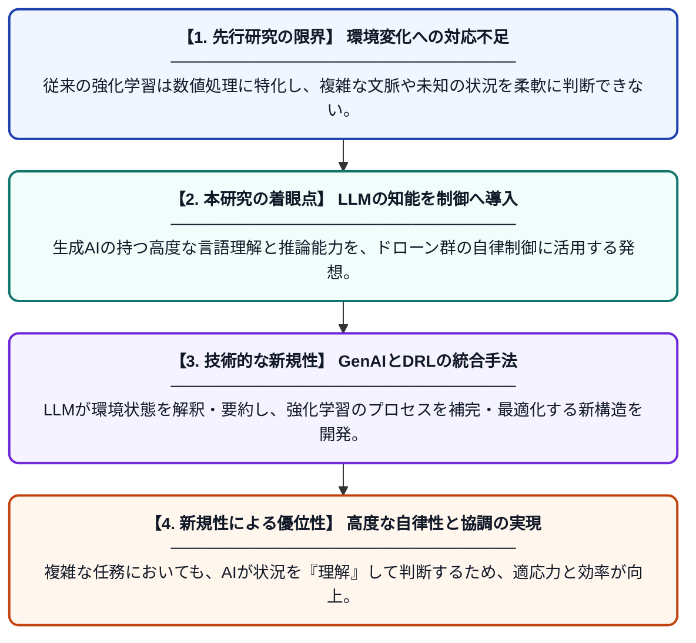

# ドローン群ネットワークの自律化に向けた生成AI統合型マルチエージェント深層強化学習フレームワーク：最新動向、ケーススタディ、および課題

**Original Title**: *Generative AI-Integrated Multi-Agent DRL Frameworks for Autonomy in UAV Swarm Networks: State-of-the-Art, Case Study, and Challenges*

> **💡 一言要約**: 生成AIでドローン群の知能と自律性を極限まで高める新手法

| 項目 | 内容 |
|---|---|
| **著者** | MM Alam, MY Arafat, M Noor-A-Rahim, D Pesch |
| **掲載誌** | Ad Hoc Networks 2026 |
| **アラートキーワード** | multi agent |
| **原文リンク** | [https://www.sciencedirect.com/science/article/pii/S1570870526003653](https://www.sciencedirect.com/science/article/pii/S1570870526003653) |
| **PDF版要約** | [README.pdf](./README.pdf) |

---

## 📊 新規性の図解（先行研究との違いと本研究のブレークスルー）

## 📝 要約

ドローン（UAV）群の自律制御において、生成AI（GenAI）とマルチエージェント深層強化学習（MA-DRL）を統合した新たなフレームワークを提案・解説する論文です。大規模言語モデル（LLM）を活用して複雑な動的環境への適応力を高める具体的な手法や、今後の研究課題について網羅的に示しています。

## ❓ どんな問題に取り組んだか

従来のドローン群制御では、動的に変化する複雑な環境下での柔軟な意思決定や、未知のシナリオに対する適応が困難でした。また、強化学習のみでは状態空間の肥大化による学習効率の低下や、高次な推論能力の欠如が課題となっていました。

## ✨ 何が新しい？何がすごい？（新規性）

本論文は、生成AI、特にLLMの高度な推論能力をマルチエージェント深層強化学習（MA-DRL）に統合した点が最大の新規性です。LLMが複雑な状態を言語的に解釈し、行動方針や報酬設計を補助することで、従来の数値ベースの学習では難しかった「文脈を理解した適応」を実現しています。具体的なケーススタディを通じて、LLM主導の自律制御がドローン群の協調性能を飛躍的に向上させることを実証しました。

## 🎓 大学1年生向けの解説

たくさんのドローンをチームとして賢く動かすのは非常に難しい課題です。これまでは、ドローンに計算パズルのような学習をさせて動かしていましたが、この研究では「ChatGPTのような生成AI」をドローンの頭脳の一部として組み込みました。これにより、ドローンが今の状況をより深く理解し、お互いに協力しながら、想定外のトラブルが起きても自分で考えて動けるようになります。
