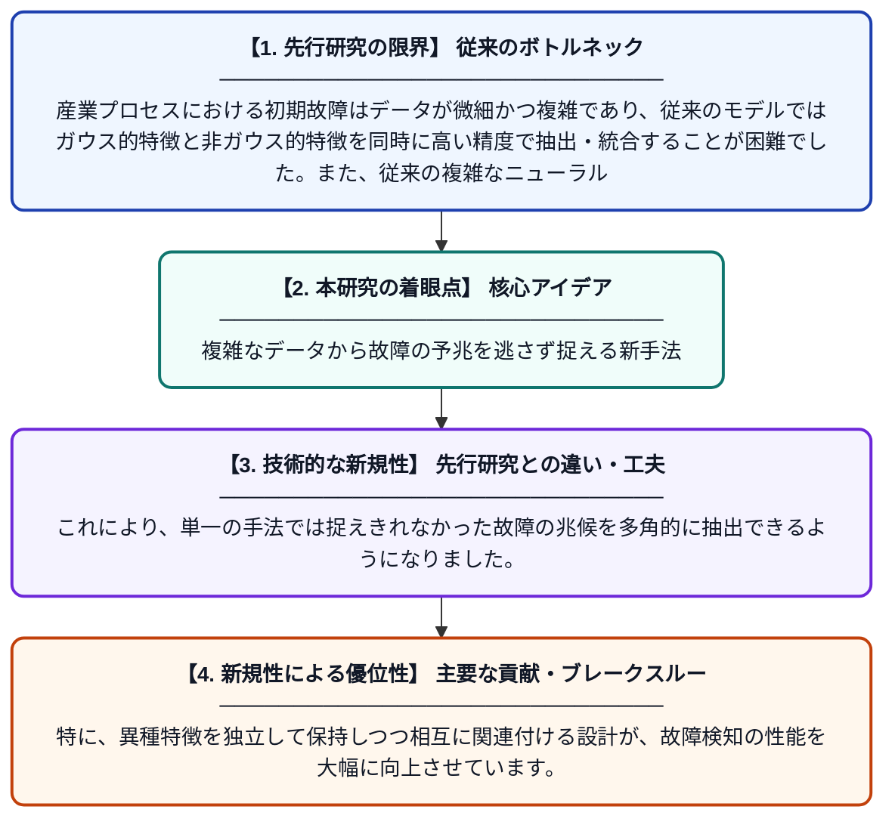

# KT-HFCA: 工業プロセスの初期故障検知に向けた異種特徴クロスアテンション付きKAN-Transformer

**Original Title**: *KT-HFCA: A KAN-Transformer with Heterogeneous-Feature Cross-Attention for Incipient Fault Detection in Industrial Processes*

> **💡 一言要約**: 複雑なデータから故障の予兆を逃さず捉える新手法

| 項目 | 内容 |
|---|---|
| **著者** | X Yu, M Chen |
| **掲載誌** | 2026 |
| **アラートキーワード** | ICA |
| **PDF** | [https://skoge.folk.ntnu.no/prost/proceedings/ifac2026_IFACWC26_preprints/files/1084.pdf](https://skoge.folk.ntnu.no/prost/proceedings/ifac2026_IFACWC26_preprints/files/1084.pdf) |
| **原文リンク** | [https://skoge.folk.ntnu.no/prost/proceedings/ifac2026_IFACWC26_preprints/files/1084.pdf](https://skoge.folk.ntnu.no/prost/proceedings/ifac2026_IFACWC26_preprints/files/1084.pdf) |
| **PDF版要約** | [README.pdf](./README.pdf) |

---

## 📊 新規性の図解（先行研究との違いと本研究のブレークスルー）

## 📝 要約

本研究は、産業プロセスの初期故障を正確に検知するため、KAN（Kolmogorov-Arnold Networks）とTransformerを融合させた新しいモデルを提案しました。PCAとICAを用いて抽出したガウスおよび非ガウスの異種特徴をクロスアテンションで統合することで、高い検知精度を実現しています。

## ❓ どんな問題に取り組んだか

産業プロセスにおける初期故障はデータが微細かつ複雑であり、従来のモデルではガウス的特徴と非ガウス的特徴を同時に高い精度で抽出・統合することが困難でした。また、従来の複雑なニューラルネットワークは計算コストや解釈性の面で課題を抱えていました。

## ✨ 何が新しい？何がすごい？（新規性）

本手法は、KANとTransformerの利点を組み合わせ、PCAとICAで抽出した異なる統計的性質を持つ特徴をクロスアテンション層で明示的に統合する点が画期的です。これにより、単一の手法では捉えきれなかった故障の兆候を多角的に抽出できるようになりました。特に、異種特徴を独立して保持しつつ相互に関連付ける設計が、故障検知の性能を大幅に向上させています。

## 🎓 大学1年生向けの解説

工場などで機械が故障する直前のわずかな変化を、AIを使って自動で見つけるための研究です。この研究では、複雑なデータを「PCA」や「ICA」という統計的な手法で細かく分解してから、「KAN-Transformer」という最新の賢いAIに学習させています。人間には気づきにくい小さな異常も、このAIならデータの特徴を組み合わせて見つけ出すことができます。つまり、機械が壊れる前に修理して、トラブルを未然に防ぐための強力なツールを開発したといえます。
