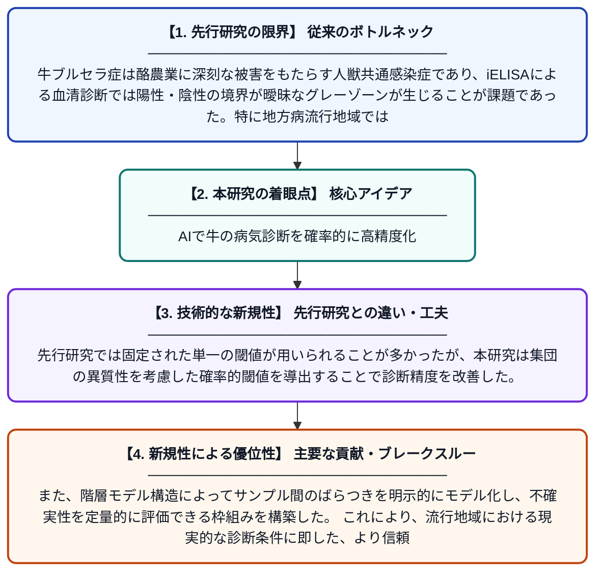

# 牛ブルセラ症の流行酪農システムにおけるiELISAの確率的閾値導出のためのベイズ階層混合モデリング

**Original Title**: *Bayesian hierarchical mixture modelling to derive probabilistic iELISA thresholds for bovine brucellosis in endemic dairy systems*

> **💡 一言要約**: AIで牛の病気診断を確率的に高精度化

| 項目 | 内容 |
|---|---|
| **著者** | MS Alam, MN Islam, BJ Adhikari, S Islam |
| **掲載誌** | PloS one 2026 |
| **アラートキーワード** | Bayesian hierarchical ... |
| **原文リンク** | [https://journals.plos.org/plosone/article?id=10.1371/journal.pone.0347719](https://journals.plos.org/plosone/article?id=10.1371/journal.pone.0347719) |
| **PDF版要約** | [README.pdf](./README.pdf) |

---

## 📊 新規性の図解（先行研究との違いと本研究のブレークスルー）

## 📝 要約

本研究は、ベイズ階層ガウス混合モデル（BHGMM）を用いて、牛ブルセラ症の血清学的診断における不確実性を解消し、iELISAの確率的閾値を導出することを目的とした。地方病が流行している酪農システムにおける不均一な血清学的データを特徴付けるため、このモデルの有用性を実証した。従来の固定的な診断閾値に代わり、統計的に信頼性の高い確率的閾値を提供することで、診断精度の向上に貢献している。

## ❓ どんな問題に取り組んだか

牛ブルセラ症は酪農業に深刻な被害をもたらす人獣共通感染症であり、iELISAによる血清診断では陽性・陰性の境界が曖昧なグレーゾーンが生じることが課題であった。特に地方病流行地域では、感染率が不均一であるため、一律の固定閾値を使用すると診断精度が低下する問題があった。このような診断の不確実性が、適切な感染制御対策の実施を妨げる要因となっていた。

## ✨ 何が新しい？何がすごい？（新規性）

本研究は、ベイズ階層ガウス混合モデルという高度な統計手法を牛ブルセラ症のiELISA診断閾値の設定に初めて体系的に適用した点が新しい。先行研究では固定された単一の閾値が用いられることが多かったが、本研究は集団の異質性を考慮した確率的閾値を導出することで診断精度を改善した。また、階層モデル構造によってサンプル間のばらつきを明示的にモデル化し、不確実性を定量的に評価できる枠組みを構築した。これにより、流行地域における現実的な診断条件に即した、より信頼性の高い意思決定支援ツールを提供している。

## 🎓 大学1年生向けの解説

牛ブルセラ症は牛から人にも感染する恐ろしい病気で、早期発見のために血液検査（iELISA）が使われています。しかし、検査結果が陽性か陰性かを判断する『境界値（閾値）』をどこに設定するかが難しく、間違いが起こりやすい問題がありました。この研究では、『ベイズ統計』という数学的手法を使って、単純な一つの数値ではなく『どのくらいの確率で病気か』を示す、より賢い閾値の決め方を開発しました。たとえるなら、体温計で『37.5度以上は発熱』と一律に決める代わりに、その人の状況に応じて発熱の可能性を確率で示すようなイメージです。これにより、病気の見逃しや誤診を減らし、酪農現場での感染対策をより適切に行えるようになります。
