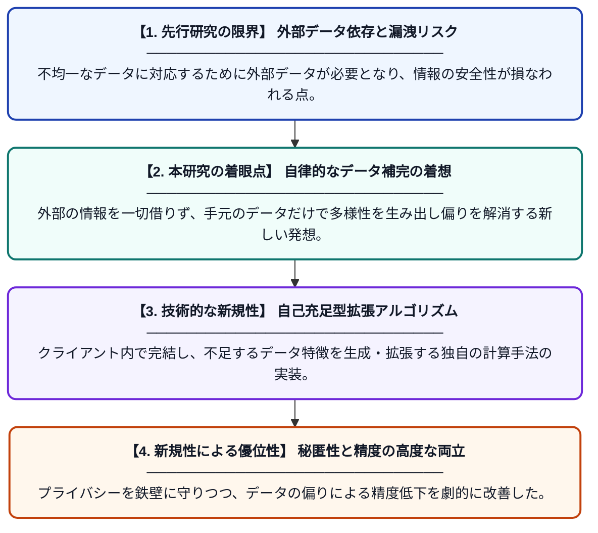

# 自己充足的なデータ拡張による不均一な連合学習の精度とプライバシーの両立

**Original Title**: *Balancing accuracy and privacy in heterogeneous federated learning via self-sufficient data augmentation*

> **💡 一言要約**: 自己完結型データ拡張で挑む、次世代の連合学習

| 項目 | 内容 |
|---|---|
| **著者** | J Zhao, G Zhang, X Wang, S Lai, C Tan, J Zhang… |
| **掲載誌** | Information Sciences 2026 |
| **アラートキーワード** | Federated Learning |
| **原文リンク** | [https://www.sciencedirect.com/science/article/pii/S0020025526012788](https://www.sciencedirect.com/science/article/pii/S0020025526012788) |
| **PDF版要約** | [README.pdf](./README.pdf) |

---

## 📊 新規性の図解（先行研究との違いと本研究のブレークスルー）

## 📝 要約

連合学習におけるデータの不均一性とプライバシー漏洩のリスクを同時に解決する新しい手法を提案した論文です。外部データに頼らず、各クライアント内でデータを補完する「自己充足的データ拡張」を導入することで、高い予測精度と強固なセキュリティを両立させました。

## ❓ どんな問題に取り組んだか

連合学習では、各ユーザーが持つデータの傾向が異なる「データの不均一性」により、モデルの精度が著しく低下する課題があります。また、精度向上を目指して情報を共有しようとすると、プライバシーが侵害されるという深刻なトレードオフが存在しました。

## ✨ 何が新しい？何がすごい？（新規性）

本研究の核心は、外部の公開データセットを一切使用せず、各クライアントが保持するデータのみで統計的な偏りを修正する「自己充足的データ拡張」を実現した点にあります。従来手法が抱えていた外部データへの依存や通信コストの増大という問題を、ローカルでの自律的なデータ生成アルゴリズムによって克服しました。これにより、プライバシー保護の制約が厳しい環境下でも、従来手法を凌駕する学習精度を達成することに成功しています。

## 🎓 大学1年生向けの解説

「連合学習」とは、みんなのスマホにあるプライベートなデータを一箇所に集めずに、バラバラの場所でAIを賢くする仕組みのことです。しかし、人によって持っている写真のジャンルがバラバラだと、AIが偏った学習をしてしまう弱点がありました。この研究では、足りないデータを自分たちで作り出して補う「魔法の補完術」を開発しました。これによって、個人の秘密を完璧に守りながら、どんなにデータの好みがバラバラな人たちの中でも、非常に賢いAIを作れるようになります。
