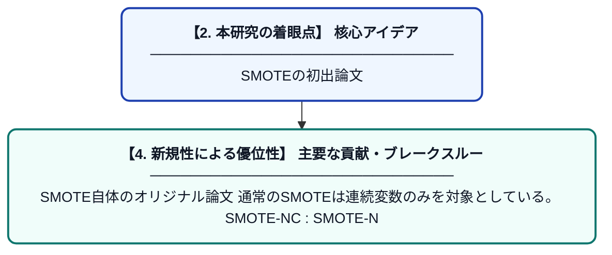

# SMOTE: Synthetic Minority Over-sampling Technique

> **💡 一言要約**: SMOTEの初出論文

| 項目 | 内容 |
|---|---|
| **PDF版要約** | [README.pdf](./README.pdf) |

---

## 📊 新規性の図解（先行研究との違いと本研究のブレークスルー）

## 📝 要約

SMOTE自体のオリジナル論文

通常のSMOTEは連続変数のみを対象としている。

SMOTE-NC :

SMOTE-N
