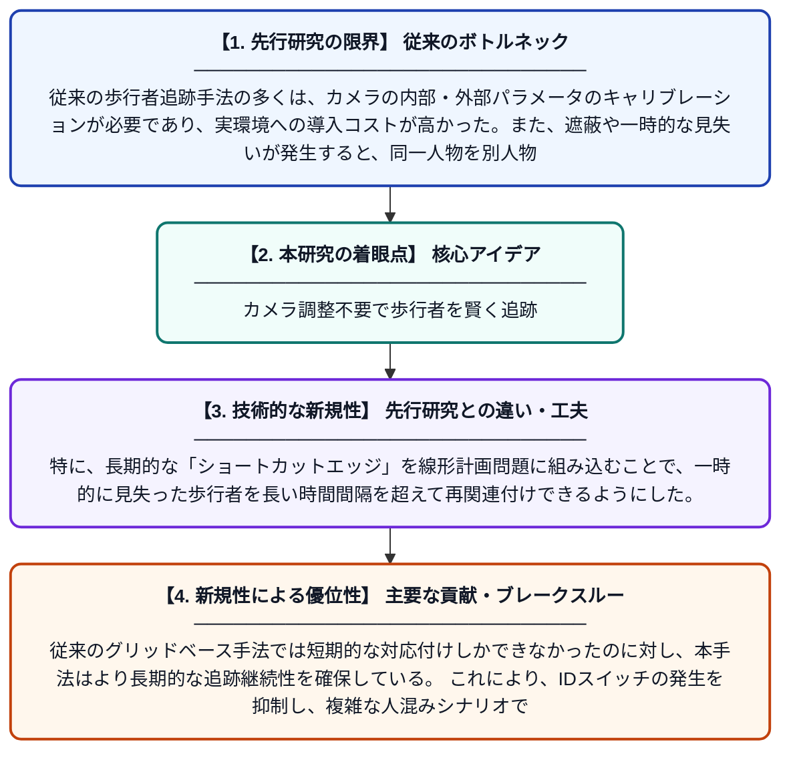

# ショートカットエッジを用いたキャリブレーション不要なグリッドベース歩行者追跡システム

**Original Title**: *Calibration-free grid-based pedestrian tracking with shortcut edge for video surveillance*

> **💡 一言要約**: カメラ調整不要で歩行者を賢く追跡

| 項目 | 内容 |
|---|---|
| **著者** | L Chen, W Zhu, C Huang, J Lou |
| **掲載誌** | Egyptian Informatics Journal 2026 |
| **アラートキーワード** | Multi Camera Tracking |
| **原文リンク** | [https://www.sciencedirect.com/science/article/pii/S1110866526001489](https://www.sciencedirect.com/science/article/pii/S1110866526001489) |
| **PDF版要約** | [README.pdf](./README.pdf) |

---

## 📊 新規性の図解（先行研究との違いと本研究のブレークスルー）

## 📝 要約

本論文は、ビデオ監視における複数歩行者の追跡問題に対し、カメラキャリブレーションを必要としないグリッドベースの追跡手法を提案している。長期的なショートカットエッジを導入した線形計画問題として追跡を定式化し直すことで、遮蔽や見逃しが発生した場合でも歩行者の同一性を維持できるようにしている。これにより、実用的な監視環境での追跡精度と頑健性の向上を実現している。

## ❓ どんな問題に取り組んだか

従来の歩行者追跡手法の多くは、カメラの内部・外部パラメータのキャリブレーションが必要であり、実環境への導入コストが高かった。また、遮蔽や一時的な見失いが発生すると、同一人物を別人物と判断してしまうID切り替え問題が生じやすかった。これらの課題が、実用的な監視システムへの応用を妨げていた。

## ✨ 何が新しい？何がすごい？（新規性）

本研究の最大の新規性は、カメラキャリブレーションを一切必要としないグリッドベースの追跡フレームワークを再定式化した点である。特に、長期的な「ショートカットエッジ」を線形計画問題に組み込むことで、一時的に見失った歩行者を長い時間間隔を超えて再関連付けできるようにした。従来のグリッドベース手法では短期的な対応付けしかできなかったのに対し、本手法はより長期的な追跡継続性を確保している。これにより、IDスイッチの発生を抑制し、複雑な人混みシナリオでの追跡精度を改善した。

## 🎓 大学1年生向けの解説

街中の監視カメラで映っている複数の人を、コンピュータが自動で「この人はさっきのあの人だ」と識別しながら追いかける技術の研究です。従来の方法はカメラの細かい設定情報が必要でしたが、この研究ではそれなしでも動くようにしました。また、人が柱の陰に隠れてしばらく見えなくなっても、再び現れたときに同じ人と正しく認識できる工夫を加えています。これは、空間をマス目（グリッド）で区切って管理し、数学的な最適化の手法で『どの人がどのマス目にいるか』を効率よく計算することで実現しています。
