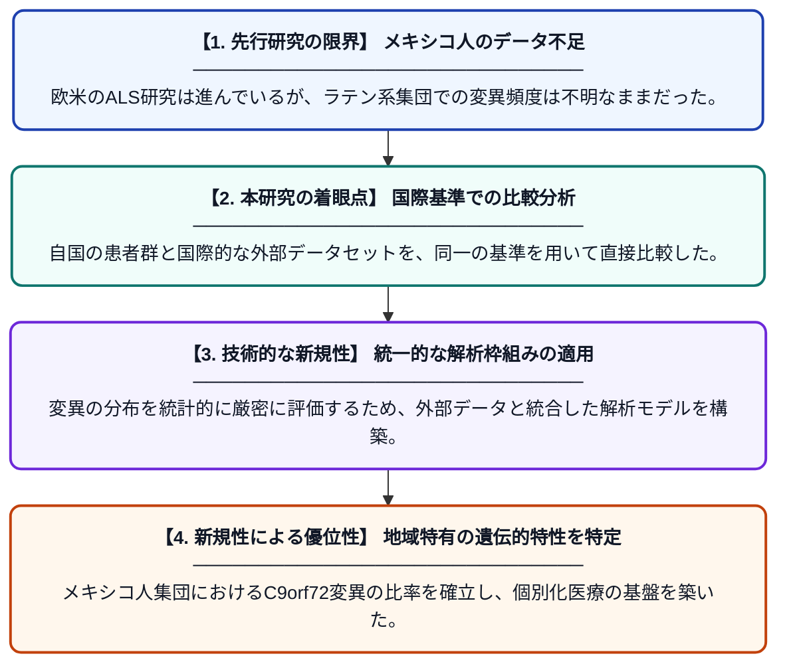

# メキシコの孤発性および家族性筋萎縮性側索硬化症（ALS）におけるC9orf72遺伝子の6塩基反復配列拡大の頻度

**Original Title**: *Prevalence of C9orf72 hexanucleotide repeat expansions in a Mexican cohort of sporadic and familial amyotrophic lateral sclerosis*

> **💡 一言要約**: メキシコ人ALS患者の遺伝的原因の頻度を解明

| 項目 | 内容 |
|---|---|
| **著者** | M Villalobos-Loredo, GK Pons-Monnier… |
| **掲載誌** | Amyotrophic Lateral … 2026 |
| **アラートキーワード** | ALS |
| **原文リンク** | [https://www.tandfonline.com/doi/full/10.1080/21678421.2026.2758563](https://www.tandfonline.com/doi/full/10.1080/21678421.2026.2758563) |
| **PDF版要約** | [README.pdf](./README.pdf) |

---

## 📊 新規性の図解（先行研究との違いと本研究のブレークスルー）

## 📝 要約

メキシコのALS患者集団を対象に、主要な原因遺伝子であるC9orf72の変異頻度を調査した研究です。自国のコホートと国際的なデータセットを比較分析し、メキシコ人における遺伝的特性を明らかにしました。

## ❓ どんな問題に取り組んだか

筋萎縮性側索硬化症（ALS）の最も一般的な原因はC9orf72遺伝子の異常ですが、その頻度は民族によって大きく異なります。これまでメキシコ人集団におけるデータは極めて不足しており、適切な診断や研究が困難な状況でした。

## ✨ 何が新しい？何がすごい？（新規性）

本研究は、メキシコのALS患者におけるC9orf72変異の分布を大規模かつ体系的に評価した点に大きな価値があります。既存の国際的なALSデータセットを対照群として用いる共通フレームワークを採用することで、他民族との正確な比較を可能にしました。これにより、ラテンアメリカ系集団特有の遺伝的背景を浮き彫りにしています。

## 🎓 大学1年生向けの解説

ALSは全身の筋肉が徐々に動かなくなる病気で、一部は遺伝子の特定の場所が「異常に長く繰り返される」ことで発症します。この研究は、その遺伝子異常がメキシコの人々の中でどれくらいの割合で見られるのかを初めて詳しく調べました。地域や人種によって遺伝子の特徴は違うため、メキシコ独自のデータを取ることは、将来的にその地域に合った治療法を作るための第一歩になります。
