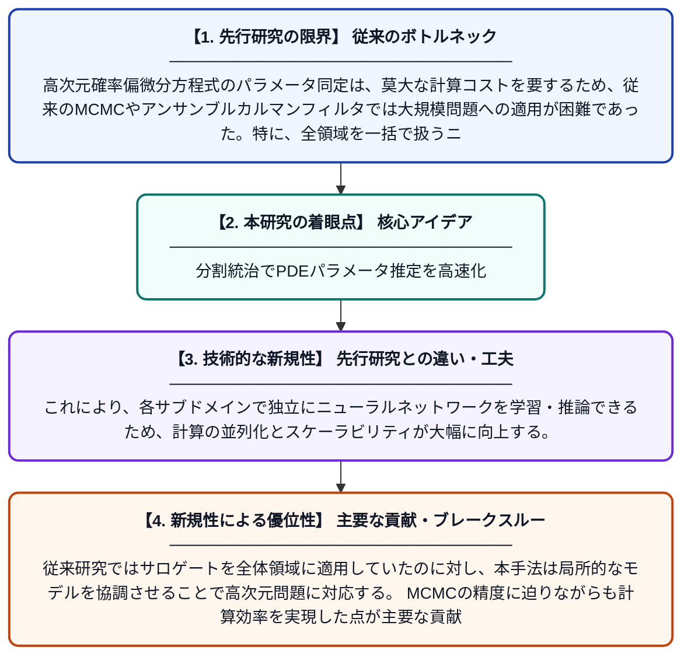

# 高次元確率偏微分方程式におけるスケーラブルな分散型アンサンブルカルマンフィルタベースパラメータ同定のための領域分割ニューラルサロゲート

**Original Title**: *Domain-Decomposition Neural Surrogates for Scalable Decentralized Ensemble Kalman Filter Based Parameter Identification in High-Dimensional Stochastic PDEs*

> **💡 一言要約**: 分割統治でPDEパラメータ推定を高速化

| 項目 | 内容 |
|---|---|
| **著者** | T Gödde, B Rosić |
| **掲載誌** | arXiv preprint arXiv:2607.24305 2026 |
| **アラートキーワード** | MCMC |
| **PDF** | [https://arxiv.org/pdf/2607.24305](https://arxiv.org/pdf/2607.24305) |
| **原文リンク** | [https://arxiv.org/abs/2607.24305](https://arxiv.org/abs/2607.24305) |
| **PDF版要約** | [README.pdf](./README.pdf) |

---

## 📊 新規性の図解（先行研究との違いと本研究のブレークスルー）

## 📝 要約

本論文は、高次元確率偏微分方程式のパラメータ同定問題に対し、領域分割法（DDM）とニューラルネットワークサロゲートモデルを組み合わせたアンサンブルカルマンフィルタ（EnKF）手法を提案する。提案手法は計算コストを分散化・スケーラブルにしながら、事後パラメータ分布を効率的に推定する。実験結果では、従来のEnKFやMCMC法に近い精度を達成しつつ、計算効率の大幅な改善を示している。

## ❓ どんな問題に取り組んだか

高次元確率偏微分方程式のパラメータ同定は、莫大な計算コストを要するため、従来のMCMCやアンサンブルカルマンフィルタでは大規模問題への適用が困難であった。特に、全領域を一括で扱うニューラルサロゲートは計算資源の観点からスケーラビリティに限界があり、実用的な大規模問題への展開が課題であった。

## ✨ 何が新しい？何がすごい？（新規性）

本研究の新規性は、領域分割法（DDM）をニューラルネットワークサロゲートと組み合わせ、分散型アンサンブルカルマンフィルタを構築した点にある。これにより、各サブドメインで独立にニューラルネットワークを学習・推論できるため、計算の並列化とスケーラビリティが大幅に向上する。従来研究ではサロゲートを全体領域に適用していたのに対し、本手法は局所的なモデルを協調させることで高次元問題に対応する。MCMCの精度に迫りながらも計算効率を実現した点が主要な貢献である。

## 🎓 大学1年生向けの解説

物理現象をコンピュータでシミュレーションするとき、方程式の中の「未知のパラメータ（例えば材料の特性）」を観測データから推定したいことがあります。しかし、現実の問題は非常に複雑で計算量が膨大になります。この研究では、問題を小さな領域に分割し、それぞれをニューラルネットワーク（AIの一種）で近似することで、計算を効率化しました。さらに「アンサンブルカルマンフィルタ」という統計的手法と組み合わせることで、未知のパラメータを確率的に推定できます。結果として、高精度な従来手法に匹敵しながら、はるかに速く計算できるようになりました。
