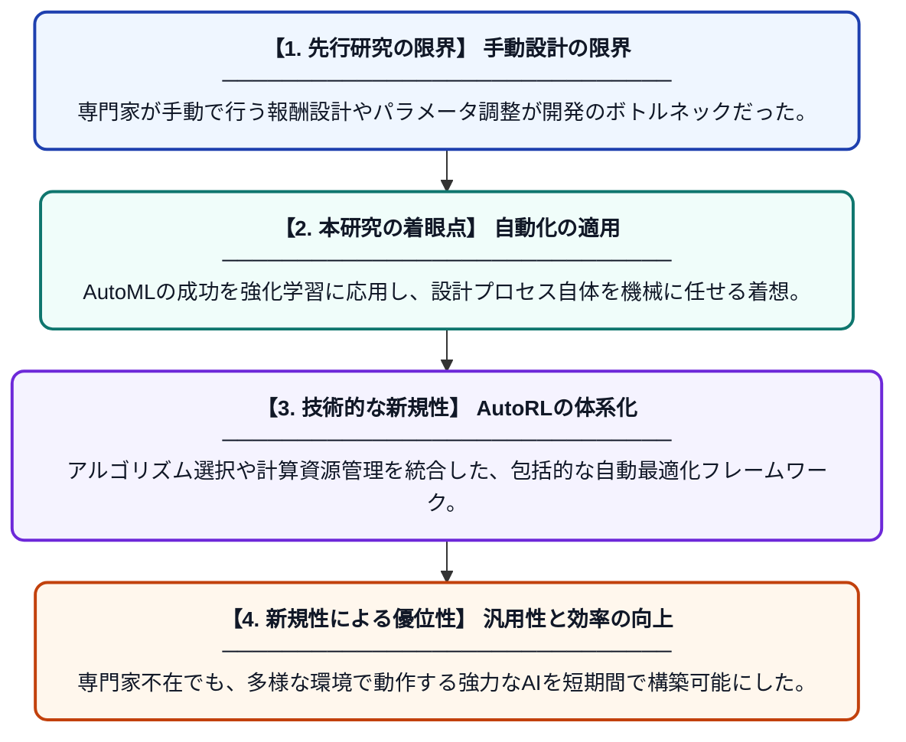

# 強化学習のための自動機械学習（AutoRL）：効率、拡張性、および汎用性の向上

**Original Title**: *Automated Machine Learning for Reinforcement Learning: Improving Efficiency, Scalability, and Generalization*

> **💡 一言要約**: 強化学習の設計を自動化しAIの民主化を加速する

| 項目 | 内容 |
|---|---|
| **著者** | SD Bairavi, PS Gowri, JJ Jayakanth, KM Monica |
| **掲載誌** | The Democratization of AI 2027 |
| **アラートキーワード** | reinforcement |
| **原文リンク** | [https://api.taylorfrancis.com/content/chapters/edit/download?identifierName=doi&identifierValue=10.1201/9781042047543-12&type=chapterpdf](https://api.taylorfrancis.com/content/chapters/edit/download?identifierName=doi&identifierValue=10.1201/9781042047543-12&type=chapterpdf) |
| **PDF版要約** | [README.pdf](./README.pdf) |

---

## 📊 新規性の図解（先行研究との違いと本研究のブレークスルー）

## 📝 要約

自動機械学習（AutoML）と強化学習（RL）を融合させた「AutoRL」という新領域について、その最新動向を体系化した研究です。強化学習の設計プロセスに潜む複雑な試行錯誤を自動化し、効率的でスケーラブルな学習システムを実現する手法を提案しています。

## ❓ どんな問題に取り組んだか

強化学習は高度な専門知識が必要で、報酬関数の設計やハイパーパラメータの調整に膨大な試行錯誤を要します。また、特定のタスクに依存しやすく、新しい環境への適応性や計算効率の面で大きな課題を抱えています。

## ✨ 何が新しい？何がすごい？（新規性）

本研究は、強化学習のワークフロー全体を自動化する「AutoRL」の包括的な枠組みを定義し、設計負荷を劇的に軽減しました。個別の最適化手法を統合し、アルゴリズムの選択から環境への適応までを一貫して自動制御するアプローチが特徴です。これにより、人間の介入なしに高度な汎用性とスケーラビリティを両立できるモデル構築の道筋を示しました。

## 🎓 大学1年生向けの解説

「強化学習」はAIが自分で試行錯誤して学びますが、その「学び方」を人間が細かく設定するのはとても大変な作業です。この研究は、その難しい設定をAI自身に自動でやらせてしまおうという「AutoRL」という技術を解説しています。これを使えば、専門的な知識がなくても、誰でも高性能なAIを効率よく作れるようになります。まさに「AIがAIを育てる」ための自動化技術です。
