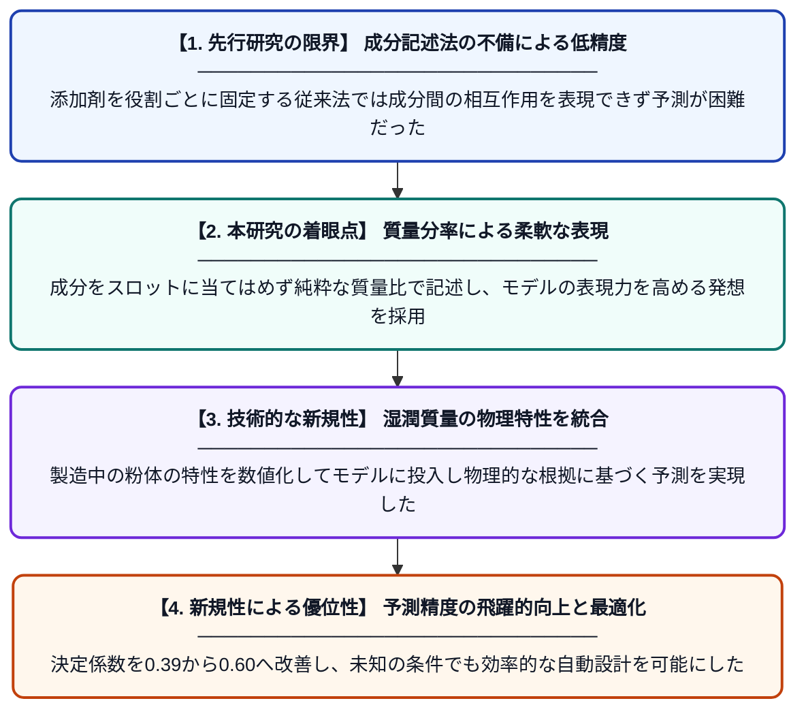

# 未知の製造可能性下における徐放性ペレットのクローズドループ処方・プロセス最適化

**Original Title**: *Closed-loop formulation–process optimization under unknown feasibility for extended-release pellets*

> **💡 一言要約**: AIと物理特性の融合で薬の設計を劇的に効率化

| 項目 | 内容 |
|---|---|
| **著者** | P Bannigan, N Saputra, M Craig, C Allen, RJ Hickman |
| **掲載誌** | 2026 |
| **アラートキーワード** | gaussian process |
| **PDF** | [https://chemrxiv.org/doi/pdf/10.26434/chemrxiv.15011645](https://chemrxiv.org/doi/pdf/10.26434/chemrxiv.15011645) |
| **原文リンク** | [https://chemrxiv.org/doi/pdf/10.26434/chemrxiv.15011645](https://chemrxiv.org/doi/pdf/10.26434/chemrxiv.15011645) |
| **PDF版要約** | [README.pdf](./README.pdf) |

---

## 📊 新規性の図解（先行研究との違いと本研究のブレークスルー）

## 📝 要約

AIを用いたクローズドループ手法により、徐放性ペレットの処方と製造プロセスを同時に最適化する手法を開発しました。添加剤の記述方法を質量分率ベースに変更し、湿潤粉体の物理特性をモデルに組み込むことで、薬物放出の予測精度を大幅に向上させることに成功しました。

## ❓ どんな問題に取り組んだか

医薬品開発では、望ましい速度で薬が溶け出す「処方」と「製造条件」の組み合わせを見つける必要があります。しかし、実際に製造可能かどうかが不明な条件下で、数多くの候補から最適な組み合わせを効率的に見つけ出すための数理的アプローチが不足していました。

## ✨ 何が新しい？何がすごい？（新規性）

従来の添加剤スロット形式の記述を、役割に依存しない「材料質量分率」に変更することで、予測精度（R2）を0.39から0.60へと大きく改善しました。さらに、製造過程における「湿潤質量」から得られる4つの物理的特性をモデルに統合しました。これにより、ガウス過程モデルを用いたクローズドループ最適化において、製造可能性の制約を考慮しつつ高精度な予測が可能になりました。

## 🎓 大学1年生向けの解説

薬の粒（ペレット）を作る際、どの成分をどれくらい混ぜて、どのような設定で機械を動かすかを決めるのは非常に複雑です。この研究では、AIに「成分の比率」と「材料の湿り具合などの物理的なデータ」を教えることで、理想的な薬の溶け方を予測する賢いシステムを作りました。これにより、実験の無駄を減らし、より確実に高品質な薬を設計できるようになります。
