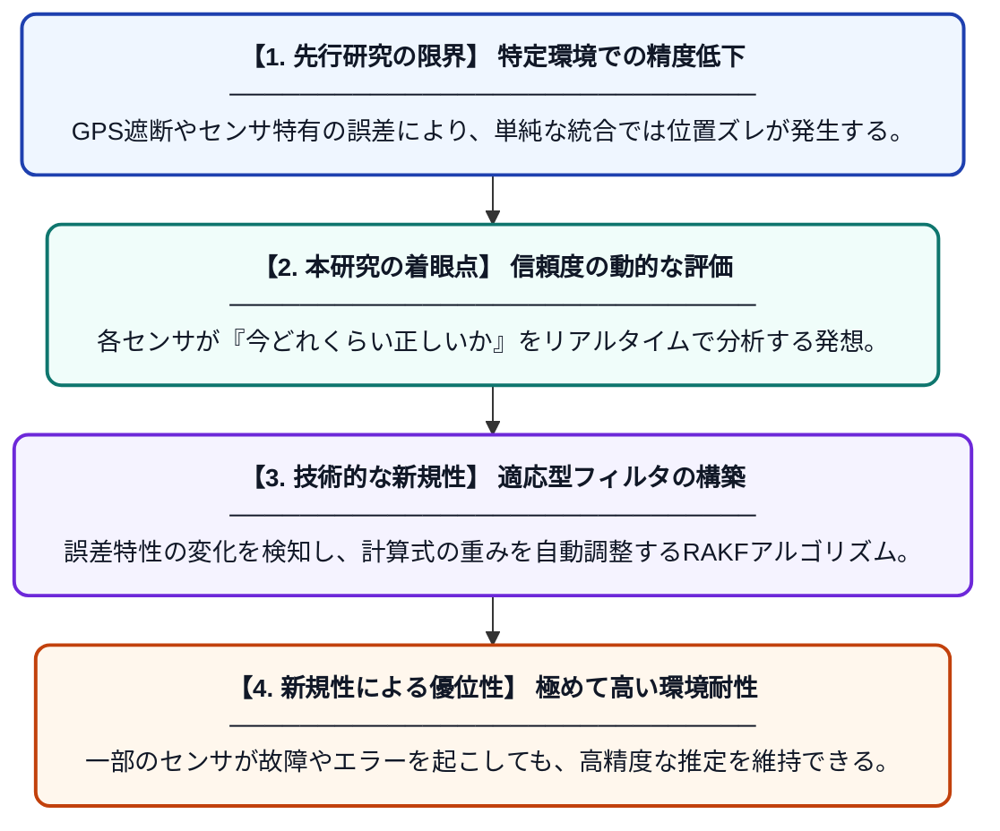

# カルマンフィルタ統合に基づく自動運転のためのマルチセンサ自己位置推定に関する研究

**Original Title**: *Research on multisensor localization for autonomous driving based on Kalman filter fusion*

> **💡 一言要約**: センサの弱点を補い合う適応型の高精度位置推定技術

| 項目 | 内容 |
|---|---|
| **著者** | Y Guo |
| **掲載誌** | International Conference on UAV Remote Sensing and … 2026 |
| **アラートキーワード** | kalman filter |
| **原文リンク** | [https://www.spiedigitallibrary.org/conference-proceedings-of-spie/14512/145120B/Research-on-multisensor-localization-for-autonomous-driving-based-on-Kalman/10.1117/12.3134656.short](https://www.spiedigitallibrary.org/conference-proceedings-of-spie/14512/145120B/Research-on-multisensor-localization-for-autonomous-driving-based-on-Kalman/10.1117/12.3134656.short) |
| **PDF版要約** | [README.pdf](./README.pdf) |

---

## 📊 新規性の図解（先行研究との違いと本研究のブレークスルー）

## 📝 要約

自動運転車において、GPS、慣性センサ、LiDAR、車輪オドメトリといった異なる誤差特性を持つ複数のセンサを統合し、高精度な位置推定を実現する手法を提案しています。提案手法である「RAKF-Loc」は、各センサの信頼性を適応的に判断することで、特定のセンサが苦手な環境下でも安定した走行を可能にします。

## ❓ どんな問題に取り組んだか

衛星測位はビル影で途切れ、LiDARは悪天候に弱く、タイヤの回転計はスリップで狂うなど、個々のセンサには必ず弱点があります。これらを単純に組み合わせるだけでは、特定の失敗モードが重なった際に位置推定が大きく狂ってしまうという課題がありました。

## ✨ 何が新しい？何がすごい？（新規性）

本研究の核心は、環境やセンサの状態に応じて統合の重みを動的に変える『信頼性適応型カルマンフィルタ（RAKF-Loc）』を開発した点にあります。従来のフィルタが固定的な誤差モデルを用いていたのに対し、本手法は各センサの異常をリアルタイムで検知し、精度の低い情報を排除・抑制する仕組みを備えています。これにより、複雑な都市環境でも極めて堅牢な位置特定を実現しました。

## 🎓 大学1年生向けの解説

自動運転車が安全に走るには『今どこにいるか』を完璧に知る必要があります。しかし、GPSが届かないトンネルや、霧で見通しが悪い道など、一つの道具（センサ）だけに頼ると必ず限界が来ます。この研究では、色々なセンサからの情報を、まるでベテランの運転手のように『今はどの情報を信じるべきか』を瞬時に判断して組み合わせる新しい計算方法を作りました。これにより、どんなに難しい道でも車が迷子にならずに済むようになります。
