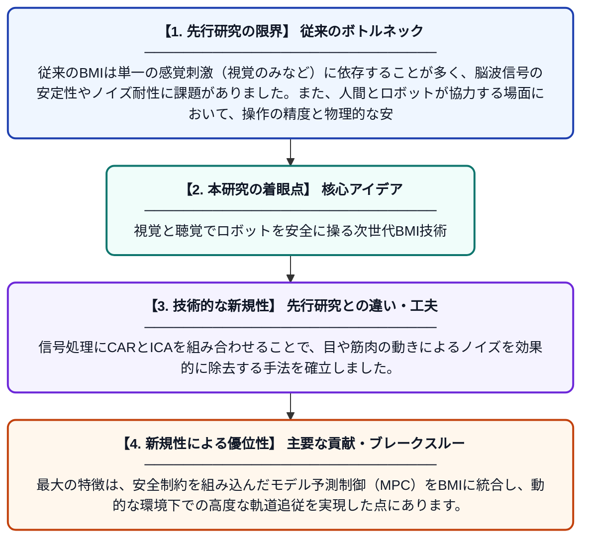

# 多モーダルな視覚・聴覚刺激に基づくBMIと安全なモデル予測制御を用いた人間・ロボット共存環境でのアーム軌道制御

**Original Title**: *Multi-Modal Audio-Visual Stimuli based Brain-Machine Interface with Safe Model Predictive Control for Robotic Arm Trajectory Tracking in Human-Robot …*

> **💡 一言要約**: 視覚と聴覚でロボットを安全に操る次世代BMI技術

| 項目 | 内容 |
|---|---|
| **著者** | A Pandey, AR Chowdhury |
| **掲載誌** | Robotica 2026 |
| **アラートキーワード** | independent component ... |
| **原文リンク** | [https://www.cambridge.org/core/journals/robotica/article/multimodal-audiovisual-stimuli-based-brainmachine-interface-with-safe-model-predictive-control-for-robotic-arm-trajectory-tracking-in-humanrobot-collaboration/72AD63A45E6941CD9AB4FF1AD0374AD2](https://www.cambridge.org/core/journals/robotica/article/multimodal-audiovisual-stimuli-based-brainmachine-interface-with-safe-model-predictive-control-for-robotic-arm-trajectory-tracking-in-humanrobot-collaboration/72AD63A45E6941CD9AB4FF1AD0374AD2) |
| **PDF版要約** | [README.pdf](./README.pdf) |

---

## 📊 新規性の図解（先行研究との違いと本研究のブレークスルー）

## 📝 要約

視覚と聴覚の刺激を組み合わせた多モーダル脳・コンピュータ・インタフェース（BMI）を開発し、ロボットアームの精密な操作を実現しました。安全性に配慮した「モデル予測制御（MPC）」を導入することで、人間が近くにいる環境でも安全かつ正確にロボットを動かすことが可能です。

## ❓ どんな問題に取り組んだか

従来のBMIは単一の感覚刺激（視覚のみなど）に依存することが多く、脳波信号の安定性やノイズ耐性に課題がありました。また、人間とロボットが協力する場面において、操作の精度と物理的な安全性を同時に確保することは困難でした。

## ✨ 何が新しい？何がすごい？（新規性）

視覚と聴覚の両方の刺激を利用することで、脳波の識別精度と安定性を大幅に向上させています。信号処理にCARとICAを組み合わせることで、目や筋肉の動きによるノイズを効果的に除去する手法を確立しました。最大の特徴は、安全制約を組み込んだモデル予測制御（MPC）をBMIに統合し、動的な環境下での高度な軌道追従を実現した点にあります。

## 🎓 大学1年生向けの解説

「脳波を使ってロボットを動かす」という技術を、より正確で安全にした研究です。まず、目と耳の両方から合図を送ることで、脳の反応をよりはっきりと読み取れるように工夫しました。さらに、ロボットが勝手に暴走したり人にぶつかったりしないよう、常に安全な動きを計算して修正する「かしこいブレーキ」のような制御を組み合わせています。これにより、考えるだけでロボットを安全かつスムーズに操作できるようになります。
