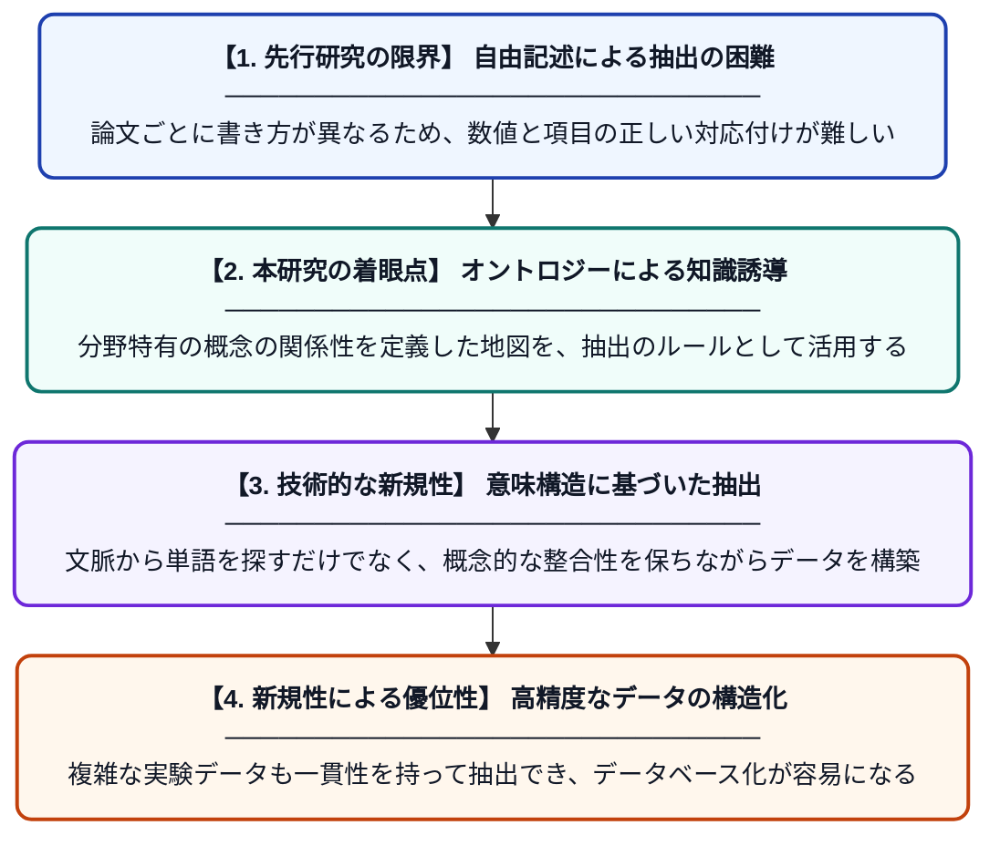

# 科学論文におけるオントロジーに基づいた実験データ抽出手法

**Original Title**: *Methods for ontology-guided extraction of experimental data in scientific articles*

> **💡 一言要約**: 知識の地図で論文から実験データを正確に抜き出す

| 項目 | 内容 |
|---|---|
| **著者** | M Lentschat, P Buche, J Cufi, L Menut, M Roche |
| **掲載誌** | 2026 |
| **アラートキーワード** | Ontology |
| **原文リンク** | [https://publications.cirad.fr/une_notice.php?dk=619920](https://publications.cirad.fr/une_notice.php?dk=619920) |
| **PDF版要約** | [README.pdf](./README.pdf) |

---

## 📊 新規性の図解（先行研究との違いと本研究のブレークスルー）

## 📝 要約

膨大な科学論文から実験データを効率的に収集するため、ドメイン知識を体系化したオントロジーを活用して情報を抽出する手法を提案しています。非構造化テキストの中から実験条件や結果などの重要な数値を、文脈を維持したまま高精度に構造化することを目指しています。

## ❓ どんな問題に取り組んだか

科学論文に記載された実験データは自由な形式で書かれているため、コンピュータが自動で情報を整理することが困難です。特に、数値、単位、対象物質の関係性を正しく紐付けるには専門的な文脈理解が必要であり、従来のキーワード抽出では精度が不十分でした。

## ✨ 何が新しい？何がすごい？（新規性）

本研究の大きな特徴は、単なる言語モデルに頼るのではなく、専門分野の概念構造（オントロジー）を抽出プロセスの「ガイド」として統合した点にあります。オントロジーを用いることで、実験データの「属性」や「関係性」を厳密に定義し、複雑な文章や表から意味の通るデータを構築できます。先行研究と比較して、特定のドメイン知識を明示的に組み込むことで、情報の欠落や誤認を大幅に低減させることに成功しました。

## 🎓 大学1年生向けの解説

科学論文には宝の山のようなデータが眠っていますが、人間が一つずつ読んで表にまとめるのは大変な作業です。この研究では、専門家が持っている「知識のつながり（オントロジー）」をコンピュータに教えることで、論文の中から必要な数字や項目を自動で見つけ出す技術を開発しました。まるで専門家が横で教えながらコンピュータに作業をさせているような仕組みで、大量の論文から新しい発見のヒントを素早く集めることができます。
