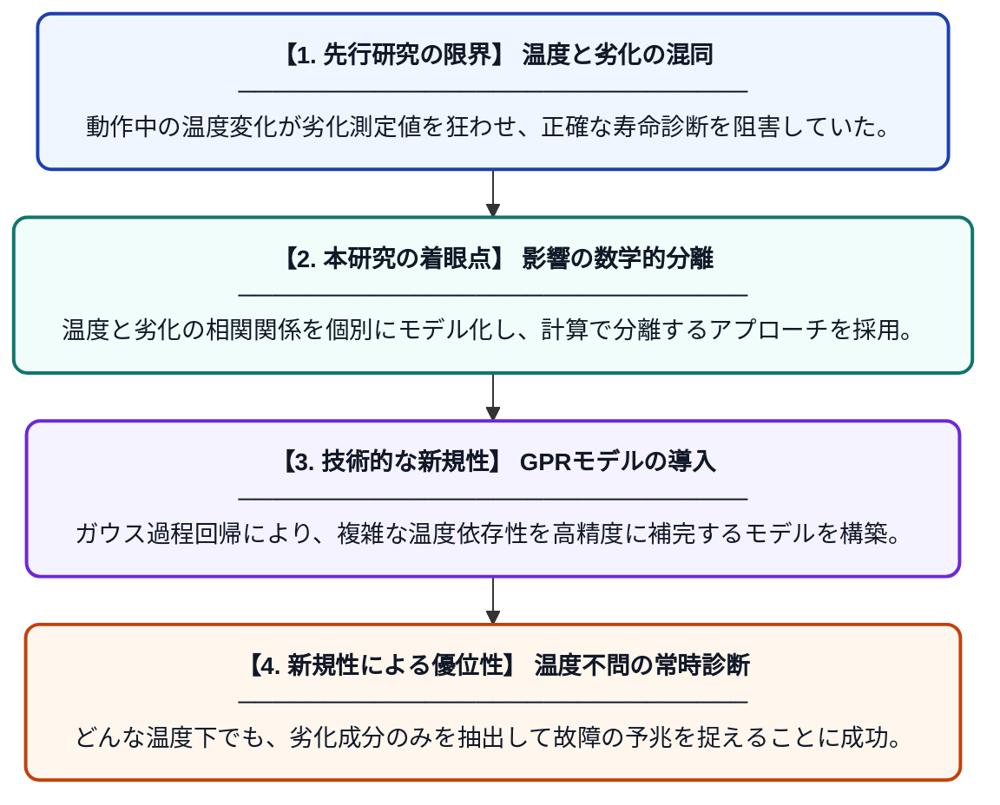

# SiC MOSFETにおけるゲート酸化膜劣化の接合温度に依存しない診断手法

**Original Title**: *A Junction-Temperature-Independent Diagnosis Method for Gate Oxide Degradation in SiC MOSFETs*

> **💡 一言要約**: 温度変化に惑わされないSiC半導体の劣化診断

| 項目 | 内容 |
|---|---|
| **著者** | D Zhao, X Yang, Q Hu, G Liu |
| **掲載誌** | IEEE Transactions on Power Electronics 2026 |
| **アラートキーワード** | gaussian process |
| **原文リンク** | [https://ieeexplore.ieee.org/abstract/document/11774957/](https://ieeexplore.ieee.org/abstract/document/11774957/) |
| **PDF版要約** | [README.pdf](./README.pdf) |

---

## 📊 新規性の図解（先行研究との違いと本研究のブレークスルー）

## 📝 要約

次世代パワー半導体であるSiC MOSFETのゲート酸化膜劣化を、デバイスの接合温度による変動に左右されずに診断する手法を提案しました。ガウス過程回帰（GPR）を用いた2つのモデルによって温度と劣化の影響を分離し、実運用下での高精度な状態監視を可能にしています。

## ❓ どんな問題に取り組んだか

SiC MOSFETの劣化診断において、デバイスの特性変化が「ゲート酸化膜の劣化」によるものか「接合温度の変化」によるものかを区別することが困難でした。このため、実運用中の温度変動が診断精度の低下や誤検知を招くという課題がありました。

## ✨ 何が新しい？何がすごい？（新規性）

本研究は、ガウス過程回帰（GPR）を活用して温度と劣化特性を分離（デカップリング）する2つのマッピングモデルを構築した点が独創的です。従来の手法とは異なり、複雑な非線形特性を考慮した温度補正プロセスを導入することで、接合温度に依存しない診断戦略を確立しました。実験により、幅広い動作温度範囲において劣化状態を高い信頼性で抽出できることを証明しています。

## 🎓 大学1年生向けの解説

電気自動車などに使われるSiC半導体は、使い続けると内部の「ゲート酸化膜」という部分が痛んできます。これをチェックしたいのですが、半導体は動いている時の温度によって性質が変わってしまうため、温度のせいか故障のせいか見分けるのが大変でした。この研究では、AIのような計算技術（ガウス過程回帰）を使って、温度の影響だけをきれいに取り除く方法を開発しました。これによって、どんなに熱い環境でも、機械を止めずに正確な寿命診断ができるようになります。
