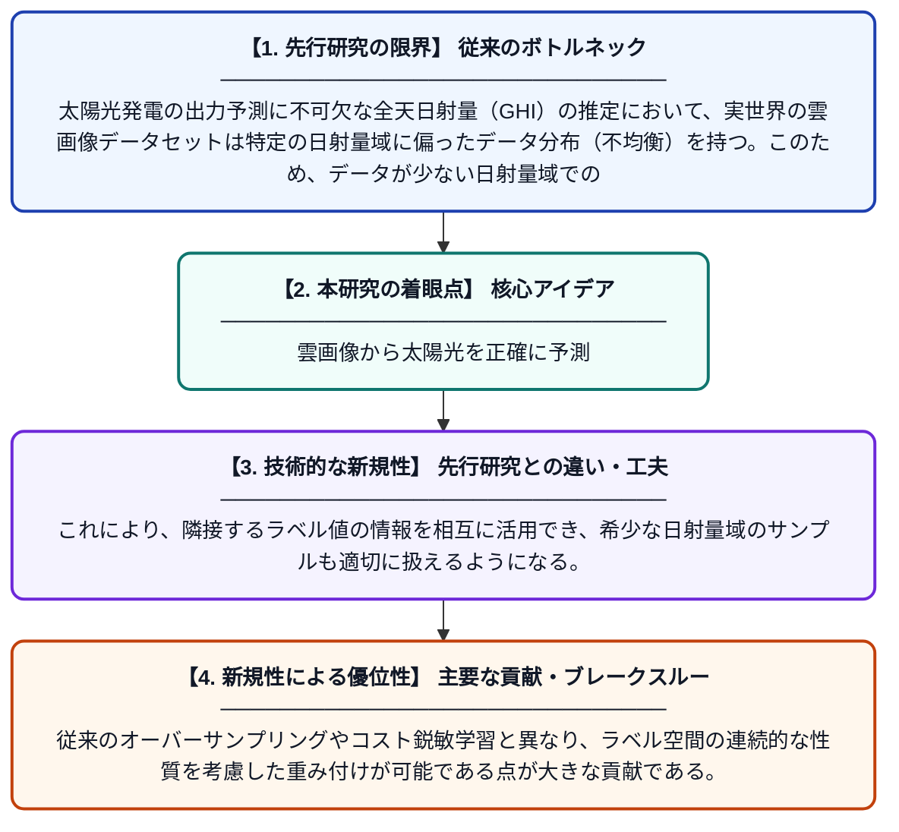

# 不均衡な雲画像データセットに対するラベル分布平滑化を用いた短期予測のための全天日射量推定の改善

**Original Title**: *Improving GHI estimation for short-term forecasting using Label Distribution Smoothing on imbalanced cloud image datasets*

> **💡 一言要約**: 雲画像から太陽光を正確に予測

| 項目 | 内容 |
|---|---|
| **著者** | S Zhang, B Zhang, Y Zhang |
| **掲載誌** | Solar Energy 2026 |
| **アラートキーワード** | kernel density estimation |
| **原文リンク** | [https://www.sciencedirect.com/science/article/pii/S0038092X26006067](https://www.sciencedirect.com/science/article/pii/S0038092X26006067) |
| **PDF版要約** | [README.pdf](./README.pdf) |

---

## 📊 新規性の図解（先行研究との違いと本研究のブレークスルー）

## 📝 要約

本論文は、太陽光発電の短期予測に重要な全天日射量（GHI）の推定精度を向上させるため、不均衡な雲画像データセットの問題に取り組んでいる。カーネル密度推定を用いたラベル分布平滑化（LDS）により、各サンプルに対して自身のラベル頻度だけでなく隣接ラベルの寄与も考慮した重みを付与する手法を提案している。これにより、データが少ない日射量域でも精度の高い予測が実現される。

## ❓ どんな問題に取り組んだか

太陽光発電の出力予測に不可欠な全天日射量（GHI）の推定において、実世界の雲画像データセットは特定の日射量域に偏ったデータ分布（不均衡）を持つ。このため、データが少ない日射量域での予測精度が著しく低下し、機械学習モデルが多数派のクラスに過度に適合してしまうという問題がある。

## ✨ 何が新しい？何がすごい？（新規性）

本研究では、ラベル分布平滑化（LDS）をGHI推定に応用することで、単純なサンプル頻度ではなくカーネル密度推定による滑らかな有効密度に基づいてサンプルの重みを決定する手法を導入した。これにより、隣接するラベル値の情報を相互に活用でき、希少な日射量域のサンプルも適切に扱えるようになる。従来のオーバーサンプリングやコスト鋭敏学習と異なり、ラベル空間の連続的な性質を考慮した重み付けが可能である点が大きな貢献である。

## 🎓 大学1年生向けの解説

太陽光パネルがどれだけ発電するかを予測するには、空の雲の様子から太陽光の強さ（日射量）を正確に推定することが大切です。しかし、学習に使うデータは晴れや曇りの日ばかり多く、珍しい天候のデータが極端に少ないという問題があります。このままモデルを学習させると、よくある天気の予測は得意でも珍しい天気の予測が苦手になってしまいます。そこでこの研究では、「ラベル分布平滑化」という方法を使い、少ないデータの日射量域にも適切な重みをつけて学習させることで、どんな天気でも精度よく予測できるようにしました。
