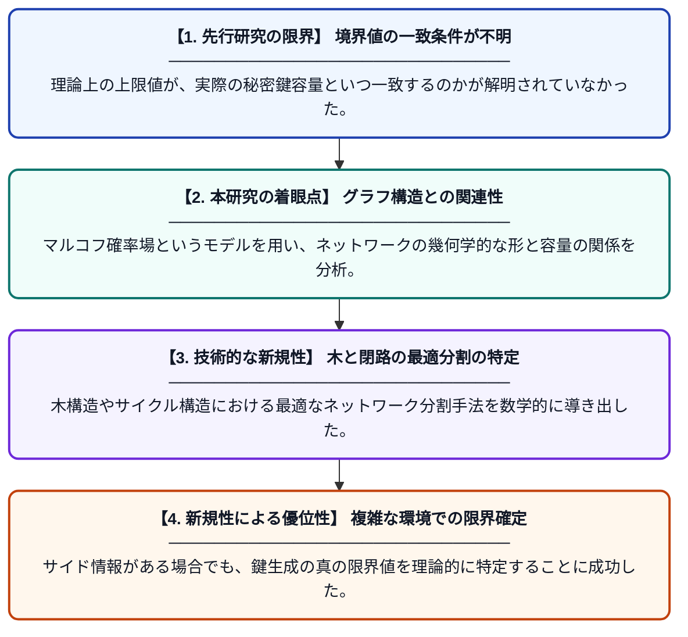

# マルチターミナル秘密鍵容量におけるパーティション・バウンドの厳密性について

**Original Title**: *Tightness of the Partition Bound for Multiterminal Secret Key Capacity*

> **💡 一言要約**: ネットの構造から秘密鍵共有の限界を数学的に特定

| 項目 | 内容 |
|---|---|
| **著者** | M Pathegama, S Bhattacharya |
| **掲載誌** | arXiv preprint arXiv:2611.29616 2026 |
| **アラートキーワード** | Markov random"  fields |
| **PDF** | [https://arxiv.org/pdf/2611.29616](https://arxiv.org/pdf/2611.29616) |
| **原文リンク** | [https://arxiv.org/pdf/2611.29616](https://arxiv.org/pdf/2611.29616) |
| **PDF版要約** | [README.pdf](./README.pdf) |

---

## 📊 新規性の図解（先行研究との違いと本研究のブレークスルー）

## 📝 要約

複数の端末間で秘密鍵を共有する際の生成効率の限界を示す「パーティション・バウンド」が、どのような条件下で実際の容量と一致するかを理論的に解明した論文です。特にマルコフ確率場における木構造や閉路構造を持つネットワークにおいて、その厳密な特性を数学的に導出しています。

## ❓ どんな問題に取り組んだか

複数の通信主体の間で秘密鍵を生成する際、その生成レートの最大値（容量）を正確に求めることは情報理論における難問です。従来、計算の指標として「パーティション・バウンド」という上限値が使われてきましたが、それがいつ真の容量と一致するのかという条件は十分に分かっていませんでした。

## ✨ 何が新しい？何がすごい？（新規性）

本論文は、マルコフ確率場（MRF）モデルにおいて、特定の端末ペア間の秘密鍵容量に対する境界の厳密性（タイトネス）を証明しました。特にグラフ理論における「木（ツリー）」や「閉路（サイクル）」といったトポロジーにおいて、どのような分割が最適であるかを具体的に特徴付けた点が画期的です。さらに、外部からのサイド情報が存在する高度な設定にも理論を拡張し、秘密鍵生成の理論的限界をより広い範囲で確定させました。

## 🎓 大学1年生向けの解説

複数の人で安全なパスワード（秘密鍵）を共有したいとき、通信の仕組み上、どうしても作れるスピードに限界があります。この研究は、通信相手が「一列に並んでいるか」「輪になっているか」といった『つながり方の形』によって、そのスピードの限界がどう決まるかを数式で解き明かしました。これまでは「たぶんこれくらいが限界だろう」という曖昧な予測だったものが、この研究によって「これが絶対に超えられない正確な限界だ」と言えるようになりました。
