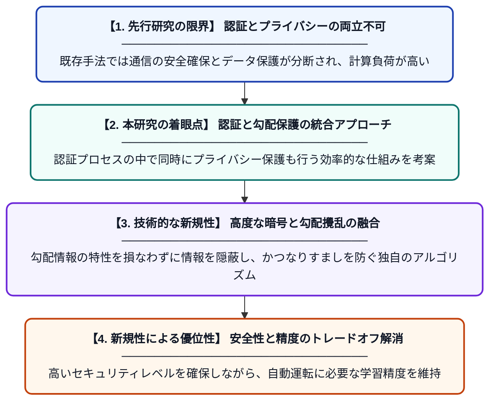

# 連合学習ベースの車載用アドホックネットワーク（VANET）における勾配プライバシーを考慮した安全な認証スキーム

**Original Title**: *A Secure Authentication Scheme With Gradient Privacy for Federated-Learning-Based VANETs*

> **💡 一言要約**: 車両のプライバシーと安全な学習を両立する認証技術

| 項目 | 内容 |
|---|---|
| **著者** | S Son, H Kwon, Y Park |
| **掲載誌** | IEEE Transactions on Intelligent Vehicles 2026 |
| **アラートキーワード** | Federated Learning |
| **原文リンク** | [https://ieeexplore.ieee.org/abstract/document/11806858/](https://ieeexplore.ieee.org/abstract/document/11806858/) |
| **PDF版要約** | [README.pdf](./README.pdf) |

---

## 📊 新規性の図解（先行研究との違いと本研究のブレークスルー）

## 📝 要約

自動運転を支援するVANET環境において、データの秘匿性を保ちながら学習を行う連合学習（FL）の安全性を高める新しい認証手法を提案しています。この手法は、学習過程でやり取りされる勾配情報からのデータ漏洩を防ぎつつ、車両の正当性を効率的に確認することができます。

## ❓ どんな問題に取り組んだか

従来の車載ネットワークでは、通信の安全性を確保するための認証と、プライバシーを保護した効率的なデータ学習を同時に実現することが困難でした。特に、連合学習において送信される「勾配データ」を解析されることで、車両の機密情報が漏洩するリスクや、不正な車両による攻撃が大きな課題となっていました。

## ✨ 何が新しい？何がすごい？（新規性）

本論文の最大の特徴は、車両の認証機能と勾配情報のプライバシー保護を一つの統合されたスキームで実現した点にあります。従来のセキュリティ手法よりも計算負荷を抑えつつ、差分プライバシーや暗号化技術を組み合わせることで、勾配データからの逆解析を困難にしています。実際の交通標識データセット（GTSRB）を用いた検証により、高い学習精度を維持しながら攻撃耐性を向上させている点が画期的です。

## 🎓 大学1年生向けの解説

車同士が情報を共有して賢くなる「自動運転のための勉強会」を想像してください。このとき、「誰が参加しているか」を正しく確認しつつ、各車両が自分のプライベートな情報を漏らさないように「勉強の内容（ヒント）」だけを加工して送る必要があります。この研究は、そのヒントを複雑な数学の力で守り、悪い人が情報を盗んだり嘘をついたりできないようにする新しい「鍵」と「ルール」を作ったものです。
