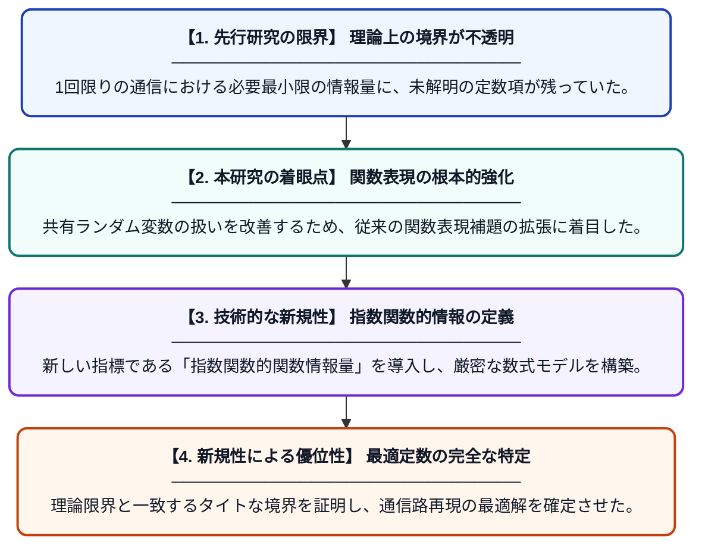

# 1回限りの通信路シミュレーションにおける最適定数と強力な関数表現補題

**Original Title**: *The Optimal Constant for One-Shot Channel Simulation and Strong Functional Representation Lemma*

> **💡 一言要約**: 通信路再現の理論的限界を数学的に完全解明

| 項目 | 内容 |
|---|---|
| **著者** | CT Li |
| **掲載誌** | arXiv preprint arXiv:2611.13397 2026 |
| **アラートキーワード** | one shot |
| **PDF** | [https://arxiv.org/pdf/2611.13397](https://arxiv.org/pdf/2611.13397) |
| **原文リンク** | [https://arxiv.org/pdf/2611.13397](https://arxiv.org/pdf/2611.13397) |
| **PDF版要約** | [README.pdf](./README.pdf) |

---

## 📊 新規性の図解（先行研究との違いと本研究のブレークスルー）

## 📝 要約

この論文は、1回限りの通信路シミュレーションにおいて、指数関数的情報量を用いたタイトな境界（理論的限界）を証明した研究です。従来の関数表現補題を強化した「強力な関数表現補題」を導入し、シミュレーションに必要な共有情報の最小コストを厳密に導出しました。

## ❓ どんな問題に取り組んだか

通信路（チャネル）を1回の試行でシミュレートする際、送信側と受信側で共有すべき情報量の最小値を特定することが課題でした。これまでの研究では理論的な境界に曖昧な定数項が残されており、真に最適な下限が分かっていませんでした。

## ✨ 何が新しい？何がすごい？（新規性）

従来の関数表現補題（FRL）を大幅に強化した「強力な関数表現補題」を提案した点が最大の特徴です。特に「指数関数的関数情報量」という概念を導入することで、シミュレーションコストのタイトな評価を可能にしました。これにより、先行研究のギャップを埋め、数学的にこれ以上改善不可能な最適定数を特定することに成功しました。

## 🎓 大学1年生向けの解説

インターネットなどで情報を送るとき、データをどれだけ効率よく「再現」できるかは非常に重要です。この論文は、たった1回きりの通信で相手に情報を伝える際、これ以上は絶対に減らせないという究極のデータ量の限界を数学で突き止めました。難しいパズルを解くための新しい「計算の公式」を編み出し、通信の仕組みをより根本から理解できるようにした研究です。
