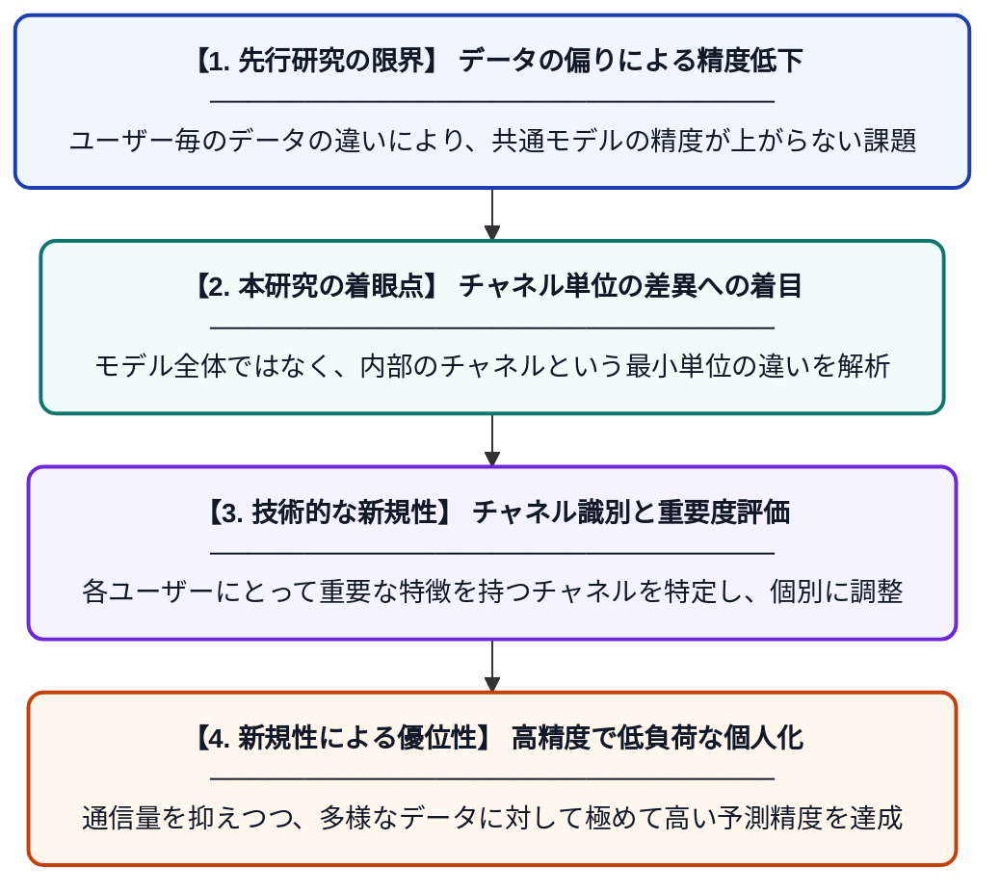

# FedCDI：チャネルの差異を利用した連合学習の細粒度パーソナライズ手法

**Original Title**: *FedCDI: Fine-grained personalization for federated learning via channel differences*

> **💡 一言要約**: チャネルの個性で賢くなる、新時代の連合学習。

| 項目 | 内容 |
|---|---|
| **著者** | K Wang, T Wang, F Chen, H Yang, Y Liu, D Xie |
| **掲載誌** | Knowledge-Based Systems 2026 |
| **アラートキーワード** | Federated Learning |
| **原文リンク** | [https://www.sciencedirect.com/science/article/pii/S0950705126019878](https://www.sciencedirect.com/science/article/pii/S0950705126019878) |
| **PDF版要約** | [README.pdf](./README.pdf) |

---

## 📊 新規性の図解（先行研究との違いと本研究のブレークスルー）

## 📝 要約

FedCDIは、データの偏りが大きい環境下での連合学習において、ニューラルネットワークのチャネルレベルでの差異に着目した新しい手法です。各クライアントの特性に応じてモデルのチャネルを選択的に最適化することで、効率的かつ高精度なパーソナライズを実現します。

## ❓ どんな問題に取り組んだか

連合学習において、各ユーザーが持つデータの傾向が大きく異なる場合、一つの共通モデルでは全員に最適な精度を提供できないという課題があります。従来の個人化手法では、モデル全体の重みを調整するため、計算コストが高く、細かい特徴の差を捉えきれない限界がありました。

## ✨ 何が新しい？何がすごい？（新規性）

本研究の最大の特徴は、モデルの構成単位である「チャネル」に着目し、クライアントごとに異なる重要な特徴を細粒度で識別する点にあります。先行研究が層単位の調整に留まっていたのに対し、FedCDIはチャネル間の差異を解析して不要な情報の干渉を抑制します。これにより、通信量を抑えつつ、多様なデータ分布に対しても極めて高い適応能力と予測精度を両立させることに成功しました。

## 🎓 大学1年生向けの解説

AIに学習をさせるとき、プライバシーを守るためにデータを1箇所に集めず、各自のスマホなどで学習させる「連合学習」という技術があります。しかし、人によって持っているデータがバラバラなため、全員にぴったりのAIを作るのは非常に困難でした。この研究では、AIの「脳」の中にある細かい部品（チャネル）を、使う人ごとに微調整する仕組みを開発しました。これにより、自分専用の賢いAIを、効率よく作ることができるようになります。
