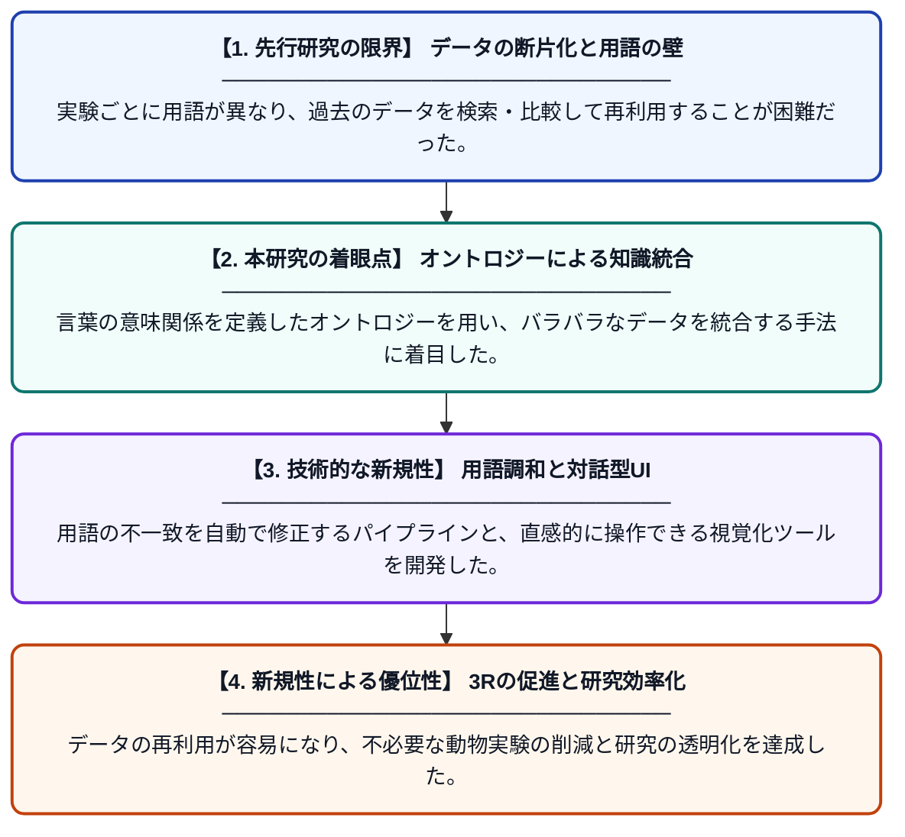

# ONITH：3Rにおけるデータ再利用のためのオントロジーに基づく非臨床統合および用語調和パイプライン

**Original Title**: *ONITH: An Ontology-based Non-clinical Integration and Term Harmonization Pipeline for Data Reuse in 3R*

> **💡 一言要約**: 3R推進！非臨床データを賢く統合・再利用。

| 項目 | 内容 |
|---|---|
| **著者** | LM Winter, JM Kraus, B Stierstorfer, N Ketter, K Hempel… |
| **掲載誌** | Computer Methods and … 2026 |
| **アラートキーワード** | Ontology |
| **原文リンク** | [https://www.sciencedirect.com/science/article/pii/S0169260726004712](https://www.sciencedirect.com/science/article/pii/S0169260726004712) |
| **PDF版要約** | [README.pdf](./README.pdf) |

---

## 📊 新規性の図解（先行研究との違いと本研究のブレークスルー）

## 📝 要約

非臨床試験データの再利用を促進し、動物実験の3R（置換・削減・改善）を支援するための統合パイプライン「ONITH」を提案する研究です。オントロジーを活用して異なるデータ間の用語を標準化し、専門家が連携しやすい対話型の視覚化インターフェースを提供します。

## ❓ どんな問題に取り組んだか

非臨床試験のデータは形式や用語がバラバラで、過去の実験結果を後の研究で再利用することが困難でした。その結果、本来は避けられたはずの重複した動物実験が行われるなど、研究の効率と倫理面の両方に課題がありました。

## ✨ 何が新しい？何がすごい？（新規性）

ONITHは、オントロジー（知識構造）の統合とバージョン管理を自動化し、異なる専門分野間での用語の不一致を解消する独自のパイプラインを構築しました。単なるデータベース化ではなく、対話的なインターフェースと視覚化機能を備えることで、分野横断的なコラボレーションと厳格なドキュメント作成を同時に実現しています。これにより、非臨床データの透明性と再利用性が飛躍的に向上しました。

## 🎓 大学1年生向けの解説

新薬の開発などで行われる動物実験の結果を、別の研究でも使い回せるように整理する仕組みについての研究です。昔の実験データを使いたくても、言葉の使い方が人によって違うと探し出せませんが、このシステムは「賢い辞書」を使って言葉のズレを自動で直してくれます。これによって、無駄な実験を減らして動物の命を大切にしつつ、研究をスムーズに進められるようになります。
