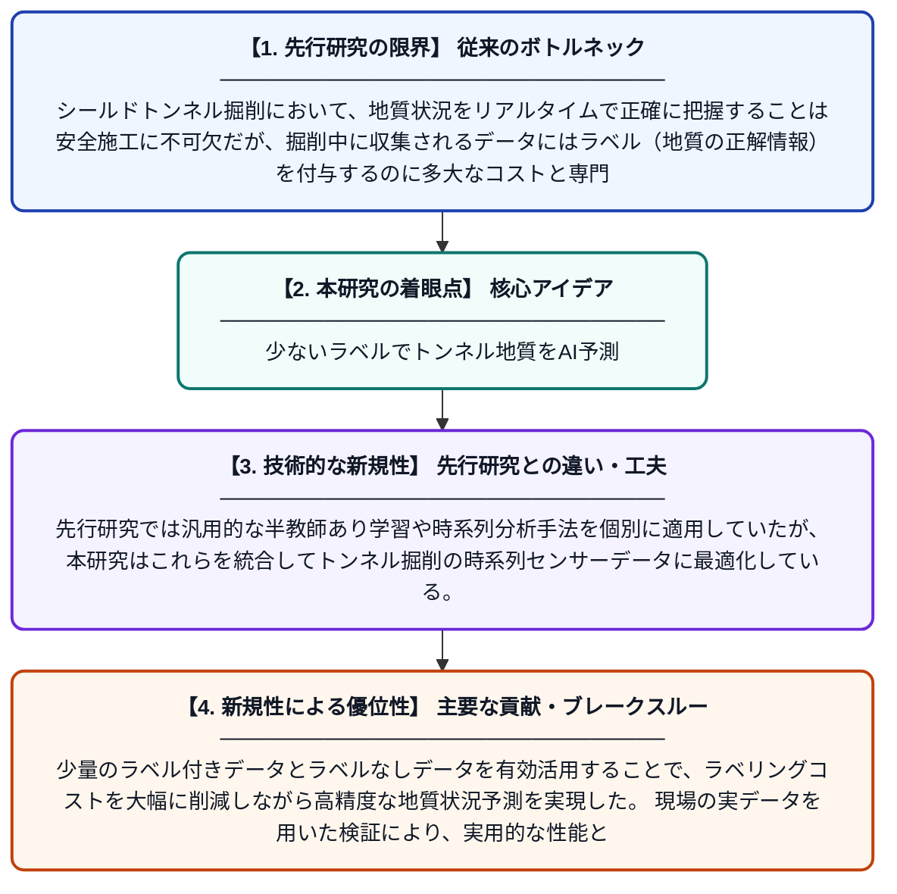

# シールドトンネル掘削におけるリアルタイム地質状況予測のための半教師あり時系列分類

**Original Title**: *Semi-supervised time series classification for real-time geological condition prediction in shield tunneling*

> **💡 一言要約**: 少ないラベルでトンネル地質をAI予測

| 項目 | 内容 |
|---|---|
| **著者** | J Zhen, M Huang, J Zheng, F Lai, JS Shiau, P Wang |
| **掲載誌** | Tunnelling and Underground Space Technology 2026 |
| **アラートキーワード** | Semi supervise |
| **原文リンク** | [https://www.sciencedirect.com/science/article/pii/S0886779826005092](https://www.sciencedirect.com/science/article/pii/S0886779826005092) |
| **PDF版要約** | [README.pdf](./README.pdf) |

---

## 📊 新規性の図解（先行研究との違いと本研究のブレークスルー）

## 📝 要約

本研究は、シールドトンネル掘削中にリアルタイムで地質状況を予測するための新しい半教師あり時系列分類モデルを提案している。ラベル付きデータが少ない現場環境でも高精度な地質判定を可能にするため、半教師あり学習を時系列データに特化した形で応用している。これにより、トンネル掘削の安全性と効率性の向上が期待される。

## ❓ どんな問題に取り組んだか

シールドトンネル掘削において、地質状況をリアルタイムで正確に把握することは安全施工に不可欠だが、掘削中に収集されるデータにはラベル（地質の正解情報）を付与するのに多大なコストと専門知識が必要となる。従来の教師あり学習手法はラベル付きデータを大量に必要とするため、実際の現場での適用が困難であった。また、既存の半教師あり学習手法は時系列データの特性や地質予測タスクに特化していないため、十分な性能が得られなかった。

## ✨ 何が新しい？何がすごい？（新規性）

本研究は、シールドトンネル掘削という特定タスクに特化した半教師あり時系列分類モデルを新たに設計した点が革新的である。先行研究では汎用的な半教師あり学習や時系列分析手法を個別に適用していたが、本研究はこれらを統合してトンネル掘削の時系列センサーデータに最適化している。少量のラベル付きデータとラベルなしデータを有効活用することで、ラベリングコストを大幅に削減しながら高精度な地質状況予測を実現した。現場の実データを用いた検証により、実用的な性能と汎用性が示されている。

## 🎓 大学1年生向けの解説

トンネルを地下に掘るとき、地面の中がどんな土や岩でできているかを工事中に素早く正確に知ることがとても重要です。しかし、その「正解データ」を人間が一つひとつ確認するのはとても大変で費用もかかります。この研究では、正解がわかっているデータが少ししかなくても、機械が自動で地質を判定できる新しいAI技術を開発しました。これは「半教師あり学習」という手法で、少ない正解データとたくさんの未ラベルデータを組み合わせて賢く学習するものです。この技術によって、トンネル工事をより安全かつ効率的に進められることが期待されています。
