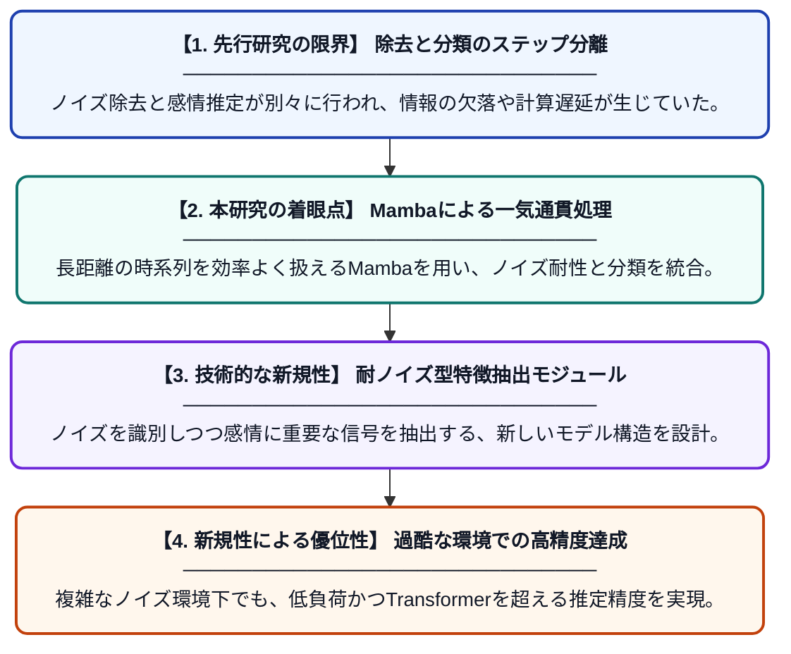

# AREMamba: 脳波のノイズ除去と感情計算を統合したアーティファクトに強いEmotion Mamba

**Original Title**: *AREMamba: Artifact-Robust Emotion Mamba for Unified EEG Denoising and Affective Computing*

> **💡 一言要約**: ノイズに負けない！次世代Mambaで脳波から感情を解読

| 項目 | 内容 |
|---|---|
| **著者** | W Dong, Z Gong, X Xu, F Wei, L Zhuo |
| **掲載誌** | Proceedings of the 34th ACM International … 2026 |
| **アラートキーワード** | affective computing |
| **原文リンク** | [https://dl.acm.org/doi/abs/10.1145/3767308.3836370](https://dl.acm.org/doi/abs/10.1145/3767308.3836370) |
| **PDF版要約** | [README.pdf](./README.pdf) |

---

## 📊 新規性の図解（先行研究との違いと本研究のブレークスルー）

## 📝 要約

脳波（EEG）信号に含まれるノイズ（アーティファクト）を除去しつつ、高精度な感情推定を同時に行う「AREMamba」を提案しています。最新のMambaアーキテクチャを活用し、ノイズ耐性の高い特徴抽出と感情分類を一つのモデルで効率的に実現しました。

## ❓ どんな問題に取り組んだか

脳波信号は時間解像度が高く感情推定に適していますが、まばたきや筋肉の動きといったノイズが混入しやすく、精度の低下を招きます。これまでの手法はノイズ除去と分類を別工程で行うものが多く、情報の損失や処理の複雑さが課題でした。

## ✨ 何が新しい？何がすごい？（新規性）

長距離データの処理に優れたState Space Model（Mamba）を脳波解析に導入し、ノイズ除去と感情分類を統合したエンドツーエンドの学習を実現しました。アーティファクトの影響を抑えるための頑健な特徴抽出モジュールを設計し、計算コストを抑えつつ高い精度を達成しています。これにより、従来のTransformerベースの手法と比較して、より実用的で堅牢な感情コンピューティングの基盤を構築しました。

## 🎓 大学1年生向けの解説

脳波を使って人の感情を読み取る技術の研究です。脳波には「まばたき」などのノイズが混じりやすく、これまでは正確な感情を当てるのが困難でした。この研究では、最新のAI技術を使って、ノイズを自動的に取り除きながら感情をピタリと当てる仕組みを開発しました。これにより、日常生活のようなノイズが多い場面でも、正しく人の気持ちを理解するコンピュータの実現に近づきました。
