# ANN駆動型カバ最適化アルゴリズムを用いたネット・ゼロ・エネルギー・ビルのためのサロゲート補助型多目的性能最適化：複数気候下での分析

**Original Title**: *… -assisted simulation-based multi-objective performance optimization for net-zero energy buildings using ANN-driven Hippopotamus optimization: A multi-climate …*

> **💡 一言要約**: カバの習性を模したAIでZEB設計を最適化

| 項目 | 内容 |
|---|---|
| **著者** | N Delgarm, S Delgarm, K Arshtabar |
| **掲載誌** | Applied Thermal Engineering 2026 |
| **アラートキーワード** | optimization |
| **原文リンク** | [https://www.sciencedirect.com/science/article/pii/S1359431126043401](https://www.sciencedirect.com/science/article/pii/S1359431126043401) |
| **PDF版要約** | [README.pdf](./README.pdf) |

---

## 📊 新規性の図解（先行研究との違いと本研究のブレークスルー）

```mermaid
%%{init: {'flowchart': {'wrappingWidth': 520, 'nodeSpacing': 18, 'rankSpacing': 28, 'padding': 14, 'curve': 'basis'}, 'themeVariables': {'fontSize': '14px'}}}%%
flowchart TD
    S1["<b>【1. 先行研究の限界】 膨大な計算時間と多目的の両立困難</b><br/>──────────────────────────────<br/>複雑な建築シミュレーションは計算負荷が高く、初期設計での迅速な判断が難しい"]
    S2["<b>【2. 本研究の着眼点】 ANNと最新アルゴリズムの融合</b><br/>──────────────────────────────<br/>AI予測モデルとカバの行動を模したHO法を組み合わせ、計算の高速化と精度向上を狙う"]
    S3["<b>【3. 技術的な新規性】 カバ最適化法による高度な探索</b><br/>──────────────────────────────<br/>建築分野で初となるHO法の実装により、広大な設計空間から効率的に最適解を導き出す"]
    S4["<b>【4. 新規性による優位性】 多気候対応の超高速ZEB設計</b><br/>──────────────────────────────<br/>様々な気候下で、エネルギー削減と快適性向上を両立する設計案を即座に提示可能"]
    S1 --> S2
    S2 --> S3
    S3 --> S4
    style S1 fill:#EFF6FF,stroke:#1E40AF,stroke-width:2px,color:#111827,rx:8,ry:8
    style S2 fill:#F0FDFA,stroke:#0F766E,stroke-width:2px,color:#111827,rx:8,ry:8
    style S3 fill:#F5F3FF,stroke:#6D28D9,stroke-width:2px,color:#111827,rx:8,ry:8
    style S4 fill:#FFF7ED,stroke:#C2410C,stroke-width:2px,color:#111827,rx:8,ry:8
```

## 📝 要約

本研究は、ネット・ゼロ・エネルギー・ビル（NZEB）の初期設計を効率化するため、人工ニューラルネットワーク（ANN）と最新の「カバ最適化（HO）」を組み合わせた新しい最適化手法を提案しています。複数の気候条件において、エネルギー消費の最小化と居住者の快適性向上を同時に達成する最適な設計解を、極めて低い計算コストで導き出すことに成功しました。

## ❓ どんな問題に取り組んだか

建物の設計初期段階において、エネルギー効率と快適性の両立を追求する多目的最適化は、膨大な計算時間を要するシミュレーションがボトルネックとなっていました。また、多様な気候条件に柔軟に対応できる、高精度かつ高速な最適化ツールの不足が課題でした。

## ✨ 何が新しい？何がすごい？（新規性）

本研究の最大の特徴は、カバの社会的な行動をモデル化した最新のメタヒューリスティック手法「Hippopotamus Optimization (HO)」を建築最適化に初めて導入し、ANNサロゲートモデルと統合した点にあります。このアプローチにより、従来のシミュレーションベースの手法と比較して計算時間を劇的に短縮しながら、パレート最適解の精度を維持・向上させています。さらに、異なる複数の気候帯でその有効性を実証し、広範な適用可能性を示した点も画期的です。

## 🎓 大学1年生向けの解説

「使うエネルギー」と「作るエネルギー」を同じにするネット・ゼロ・エネルギー・ビルを建てるには、窓の大きさや壁の厚さなど、何万通りもの組み合わせから一番良いものを選ぶ必要があります。これまではコンピューターが何日もかけて計算していましたが、この研究では「カバの群れの動き」をヒントにした新しい計算方法と、AI（ニューラルネットワーク）を使うことで、一瞬で正解を出せるようにしました。これにより、世界中のどんな場所でも、地球に優しくて人間が快適に過ごせる家を簡単に設計できるようになります。
