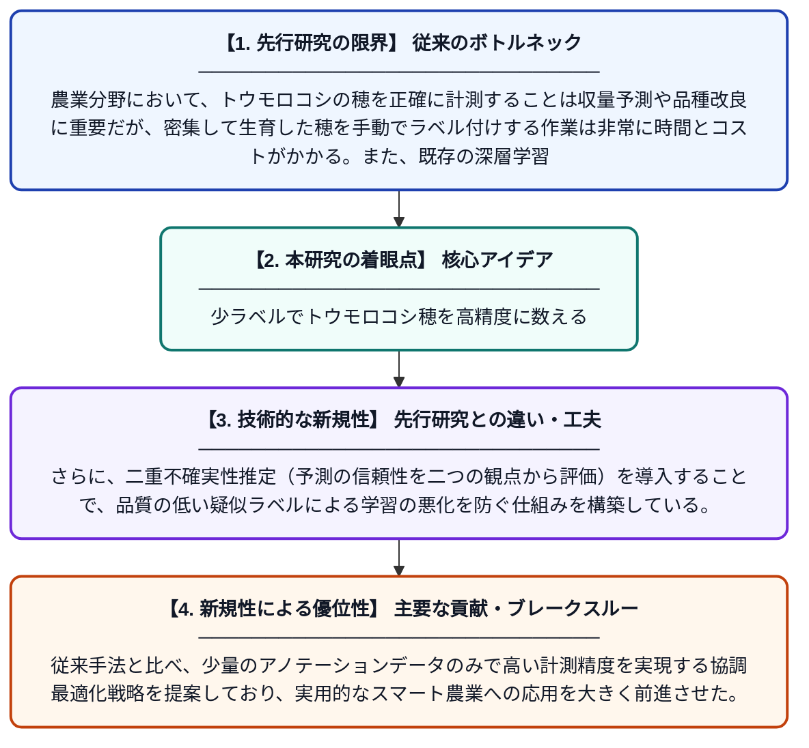

# 少ないアノテーションによる高密度トウモロコシ穂数計測：PPA強化と二重不確実性駆動型半教師あり学習フレームワーク

**Original Title**: *Low-Annotation Dense Maize Tassel Counting: A PPA Enhanced and Dual Uncertainty-Driven Semi-Supervised Framework*

> **💡 一言要約**: 少ラベルでトウモロコシ穂を高精度に数える

| 項目 | 内容 |
|---|---|
| **著者** | Y Wang, Y Wang, Z Pan, C Zhou, Y Chen, J Tan, Z Lin |
| **掲載誌** | Smart Agricultural Technology 2026 |
| **アラートキーワード** | Semi supervise |
| **原文リンク** | [https://www.sciencedirect.com/science/article/pii/S2772375526006726](https://www.sciencedirect.com/science/article/pii/S2772375526006726) |
| **PDF版要約** | [README.pdf](./README.pdf) |

---

## 📊 新規性の図解（先行研究との違いと本研究のブレークスルー）

## 📝 要約

本論文は、トウモロコシの穂（タッセル）を高精度に自動計測するための半教師あり学習フレームワークを提案している。少量のラベル付きデータと大量のラベルなしデータを効果的に活用するため、PPA（Progressive Pseudo-label Augmentation）強化と二重不確実性推定を組み合わせた協調最適化戦略を導入している。これにより、アノテーションコストを大幅に削減しながら、密集した穂の計測精度を向上させることに成功している。

## ❓ どんな問題に取り組んだか

農業分野において、トウモロコシの穂を正確に計測することは収量予測や品種改良に重要だが、密集して生育した穂を手動でラベル付けする作業は非常に時間とコストがかかる。また、既存の深層学習モデルは大量のアノテーション済みデータを必要とするため、現場への適用が困難であった。

## ✨ 何が新しい？何がすごい？（新規性）

本研究は、ラベルなしデータを最大限に活用する半教師あり学習に、PPA（Progressive Pseudo-label Augmentation）という段階的な疑似ラベル強化手法を組み込んだ点が新しい。さらに、二重不確実性推定（予測の信頼性を二つの観点から評価）を導入することで、品質の低い疑似ラベルによる学習の悪化を防ぐ仕組みを構築している。従来手法と比べ、少量のアノテーションデータのみで高い計測精度を実現する協調最適化戦略を提案しており、実用的なスマート農業への応用を大きく前進させた。

## 🎓 大学1年生向けの解説

トウモロコシの畑で穂がいくつあるかを写真から自動で数えるAIを作る研究です。AIを賢くするには大量の「正解ラベル（どこに穂があるかの印）」が必要ですが、これを人が手作業でつけるのはとても大変です。そこでこの研究では、少しの正解データと大量の正解なしデータを組み合わせて学習する「半教師あり学習」という方法を使いました。さらに、AIが自分で作った「仮の答え」の信頼度を二つの方法で評価し、間違いを減らす工夫をしています。その結果、少ない手間で高精度な穂の自動計測が可能になりました。
