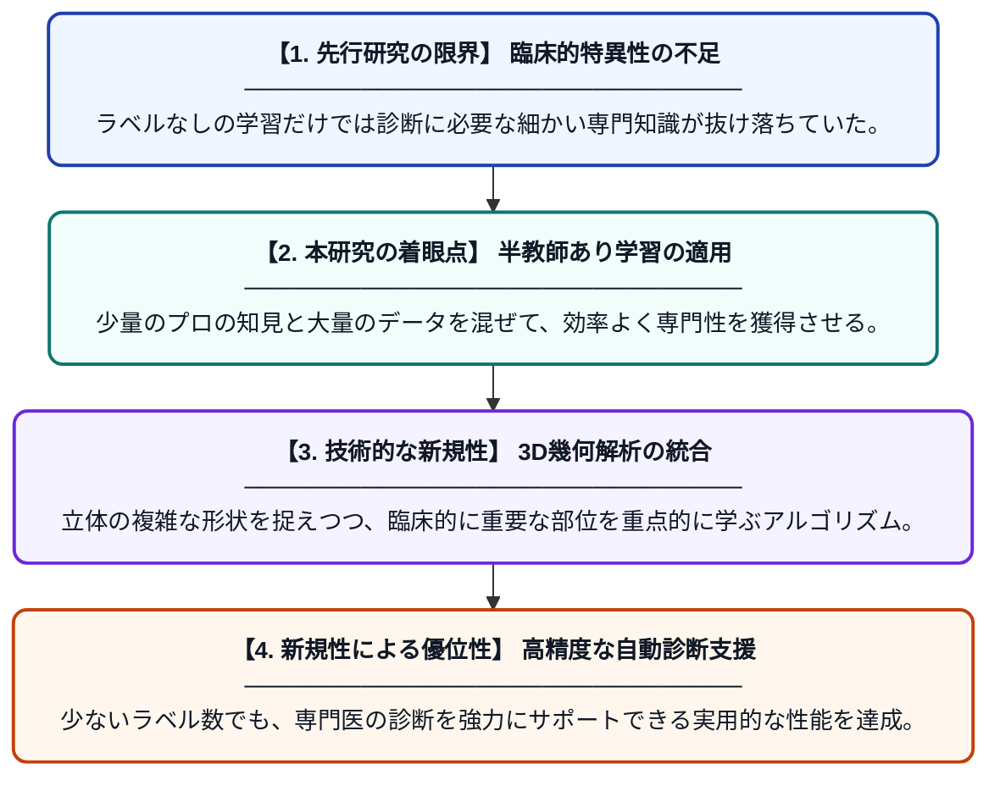

# 3D口腔内画像を用いた半教師あり学習による歯科・顎顔面異常の分類

**Original Title**: *Semi-Supervised Classification of Dental and Maxillofacial Abnormalities Using Three-Dimensional Intraoral Imaging*

> **💡 一言要約**: 3D画像と半教師あり学習で歯科診断の精度と効率を両立

| 項目 | 内容 |
|---|---|
| **著者** | A Llobet |
| **掲載誌** | Artificial Intelligence and Machine Learning Systems 2026 |
| **アラートキーワード** | Semi supervise |
| **PDF** | [https://aiamls.org/index.php/homepage/article/download/286/284](https://aiamls.org/index.php/homepage/article/download/286/284) |
| **原文リンク** | [https://aiamls.org/index.php/homepage/article/download/286/284](https://aiamls.org/index.php/homepage/article/download/286/284) |
| **PDF版要約** | [README.pdf](./README.pdf) |

---

## 📊 新規性の図解（先行研究との違いと本研究のブレークスルー）

## 📝 要約

3D口腔内画像から歯科および顎顔面の異常を自動分類するための半教師あり学習フレームワークを提案する研究です。従来の自己教師あり学習では不十分だった臨床的な専門性を、少量のラベル付きデータを効果的に活用することで補完し、高精度な診断支援を実現しています。

## ❓ どんな問題に取り組んだか

歯科分野の3D画像データは増加していますが、専門医による詳細なラベル付けには膨大な時間とコストがかかります。一方で、ラベルを使用しない自己教師あり学習だけでは、実際の診断に不可欠な臨床的な細部（特異性）を十分に学習できないという課題がありました。

## ✨ 何が新しい？何がすごい？（新規性）

本研究の最大の新規性は、3D口腔内画像解析に半教師あり学習を導入し、技術的な堅牢性と臨床的な妥当性を両立させた点にあります。少量のラベル付きデータから得られる専門知識と、大量の未ラベルデータから得られる幾何学的特徴を統合する新しい設計を開発しました。これにより、先行研究の自己教師ありモデルが抱えていた臨床精度の不足を克服し、実用的な診断支援ルートを確立しました。

## 🎓 大学1年生向けの解説

歯医者さんで撮影する3Dの歯の画像から、異常を自動で見つけるAIを作る研究です。AIに勉強させるには「これが異常です」という先生の教え（ラベル）が必要ですが、全ての画像に教えを付けるのは大変すぎます。そこで、少しの教えとたくさんの「教えがない画像」を組み合わせて賢くなる特殊な学習方法を開発しました。これにより、先生の手間を減らしつつ、正確に病気を見つけられるようになります。
