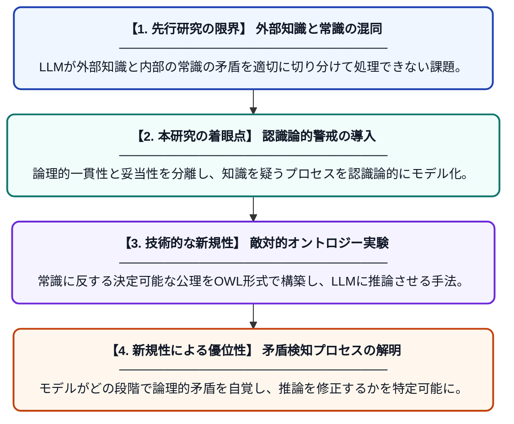

# オントロジーに基づくLLMにおける矛盾認識：認識論的視点

**Original Title**: *Contradiction Awareness in Ontology-grounded LLMs: An Epistemological Perspective*

> **💡 一言要約**: 常識外の知識に挑む、LLMの論理的矛盾検知。

| 項目 | 内容 |
|---|---|
| **著者** | E Damiano, F Orciuoli |
| **掲載誌** | 2026 |
| **アラートキーワード** | Ontology |
| **PDF** | [https://ceur-ws.org/Vol-4332/paper6.pdf](https://ceur-ws.org/Vol-4332/paper6.pdf) |
| **原文リンク** | [https://ceur-ws.org/Vol-4332/paper6.pdf](https://ceur-ws.org/Vol-4332/paper6.pdf) |
| **PDF版要約** | [README.pdf](./README.pdf) |

---

## 📊 新規性の図解（先行研究との違いと本研究のブレークスルー）

## 📝 要約

大規模言語モデル（LLM）が、自身の常識とは異なる「反常識的」な論理ルールを提示された際に、どのように矛盾を検知し推論するかを調査した研究です。認識論的な観点から、情報の信憑性が保証された状況下で、モデルが論理的な一貫性と内容の妥当性をどのように天秤にかけるかを実験的に評価しています。

## ❓ どんな問題に取り組んだか

LLMは外部知識を利用する際、その内容が自身の学習した常識と矛盾すると、適切な判断ができなくなる「幻覚」や「盲信」の問題があります。特に、外部から与えられた情報の論理的な一貫性と、内容がもっともらしいかという妥当性を、AIがどのように区別して監視しているかが不明確でした。

## ✨ 何が新しい？何がすごい？（新規性）

本研究は、意図的に常識に反する公理を組み込んだ「敵対的OWLオントロジー」を推論に用いるパイロット実験を行いました。最大の特徴は、情報の信頼性を固定したまま、論理的一貫性と妥当性に基づく「認識論的警戒（epistemic vigilance）」を切り分けて測定できる枠組みを構築した点です。これにより、LLMが外部知識を単に受け入れるだけでなく、論理的な矛盾をどの程度自覚できるかを定量的に示しました。

## 🎓 大学1年生向けの解説

AIに「太陽は西から昇る」という偽のルールを教えたときに、AIがそれをそのまま信じるか、それとも「自分の知識と違う」と矛盾に気づくかを調べた研究です。私たちは普段、相手の話が本当かどうかを論理的に判断しますが、AIにもその「疑う力」があるかを哲学的な視点からテストしています。AIが外部の知識を鵜呑みにせず、矛盾を自分で見つけられるようになれば、より正確で信頼できるAIを作ることができます。この研究は、AIがどうやって「知る」のかという深い仕組みを探っています。
