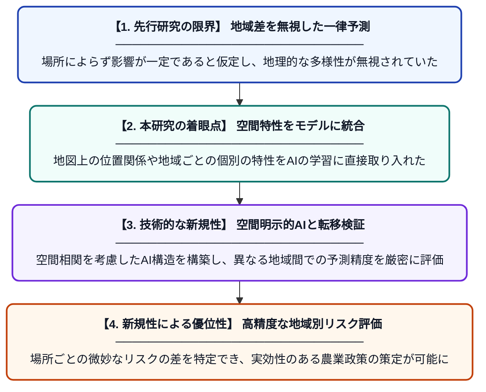

# テキサス州における綿花生産の気候リスク評価と適応政策のための空間明示的AIフレームワーク

**Original Title**: *Spatially explicit artificial intelligence framework for climate risk assessment and adaptation policy of cotton production in Texas*

> **💡 一言要約**: 空間AIでテキサスの綿花を気候変動から守る

| 項目 | 内容 |
|---|---|
| **著者** | MHAH Khan, X Wang, AA Kafy, AM ALjohani… |
| **掲載誌** | Environmental Sciences … 2026 |
| **アラートキーワード** | MCMC |
| **原文リンク** | [https://link.springer.com/article/10.1186/s12302-026-01529-y](https://link.springer.com/article/10.1186/s12302-026-01529-y) |
| **PDF版要約** | [README.pdf](./README.pdf) |

---

## 📊 新規性の図解（先行研究との違いと本研究のブレークスルー）

## 📝 要約

米国の綿花生産の約4割を占めるテキサス州を対象に、空間的な地理特性を考慮したAIモデルを用いて気候変動リスクを評価しました。従来のモデルが抱えていた「場所による影響の差（空間的非定常性）」を考慮できないという課題を克服し、より精密な適応策の策定を可能にしています。

## ❓ どんな問題に取り組んだか

従来の気候リスク評価モデルは、場所が変わっても影響の受け方が一定であると仮定する「空間的定常性」に基づいており、実際の地理的な多様性を反映できていませんでした。また、ある地域で学習したモデルが別の地域で通用するかという空間的な転移性の検証も不十分でした。

## ✨ 何が新しい？何がすごい？（新規性）

本研究は、地理的な位置情報を直接モデルに組み込む「空間明示的（Spatially explicit）」なAIフレームワークを導入した点が最大の特徴です。地理的重み付けや空間相関を考慮することで、テキサス州内の地域ごとに異なる気候影響の差異を高い精度で捉えることに成功しました。さらに、未知の地域へのモデルの適用能力を厳密に検証し、実効性の高い適応政策の指針を提示したことが主要な貢献です。

## 🎓 大学1年生向けの解説

テキサス州は綿花の巨大な産地ですが、地球温暖化などの気候変動によって生産が不安定になっています。これまでの予測モデルは「どこでも同じように被害が出る」と考えがちでしたが、実際には土地の性質や天候は場所ごとに異なります。この研究では、最新のAIを使って「場所ごとの個別の事情」を正確に読み解く仕組みを作りました。これにより、どの地域でどんな対策をすべきか、地図を見ながら正確に判断できるようになります。
