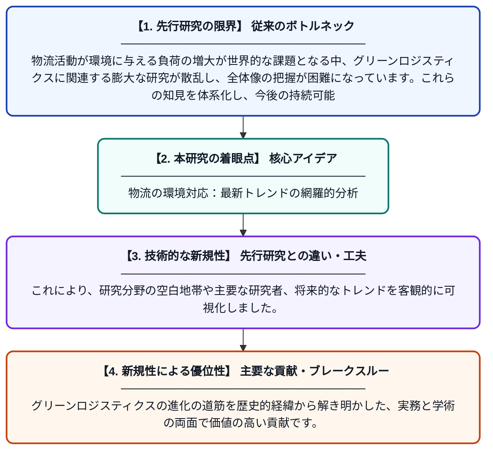

# 持続可能なサプライチェーン・マネジメントの書誌学的レビュー：グリーンロジスティクス

**Original Title**: *A Bibliometric Review of Sustainable Supply Chain Management: Green Logistics*

> **💡 一言要約**: 物流の環境対応：最新トレンドの網羅的分析

| 項目 | 内容 |
|---|---|
| **著者** | RK Saxena, R Jain, P Garg, R Pansari, P Agrawal… |
| **掲載誌** | International Journal of … 2026 |
| **アラートキーワード** | logistics |
| **PDF** | [https://ijsrem.com/download/a-bibliometric-review-of-sustainable-supply-chain-management-green-logistics/fulltext.pdf](https://ijsrem.com/download/a-bibliometric-review-of-sustainable-supply-chain-management-green-logistics/fulltext.pdf) |
| **原文リンク** | [https://ijsrem.com/download/a-bibliometric-review-of-sustainable-supply-chain-management-green-logistics/fulltext.pdf](https://ijsrem.com/download/a-bibliometric-review-of-sustainable-supply-chain-management-green-logistics/fulltext.pdf) |
| **PDF版要約** | [README.pdf](./README.pdf) |

---

## 📊 新規性の図解（先行研究との違いと本研究のブレークスルー）

## 📝 要約

本論文は、2024年に1.51兆ドル規模に達したグリーンロジスティクス市場を対象に、その研究の潮流を文献学的に分析したものです。環境負荷の低減と物流効率の両立に向けた学術的知見を整理し、将来の成長予測と重要性を明らかにしています。

## ❓ どんな問題に取り組んだか

物流活動が環境に与える負荷の増大が世界的な課題となる中、グリーンロジスティクスに関連する膨大な研究が散乱し、全体像の把握が困難になっています。これらの知見を体系化し、今後の持続可能な物流戦略にどう活用するかが課題です。

## ✨ 何が新しい？何がすごい？（新規性）

従来の個別の事例研究とは異なり、膨大な過去の文献データを統計的・書誌学的手法で包括的に分析した点が最大の新規性です。これにより、研究分野の空白地帯や主要な研究者、将来的なトレンドを客観的に可視化しました。グリーンロジスティクスの進化の道筋を歴史的経緯から解き明かした、実務と学術の両面で価値の高い貢献です。

## 🎓 大学1年生向けの解説

「グリーンロジスティクス」とは、荷物を運ぶ際の環境汚染を減らしつつ、効率よく届ける仕組みのことです。この論文は、世界中で増え続ける「環境に優しい物流」に関する研究を大量に集めて、何が大事で、これからどうなっていくかを整理しました。物流が地球環境にどう関わっているのか、最新の学術データをもとにわかりやすく解説しています。ビジネスと環境保全のバランスを考える上で、非常に重要な一冊です。
