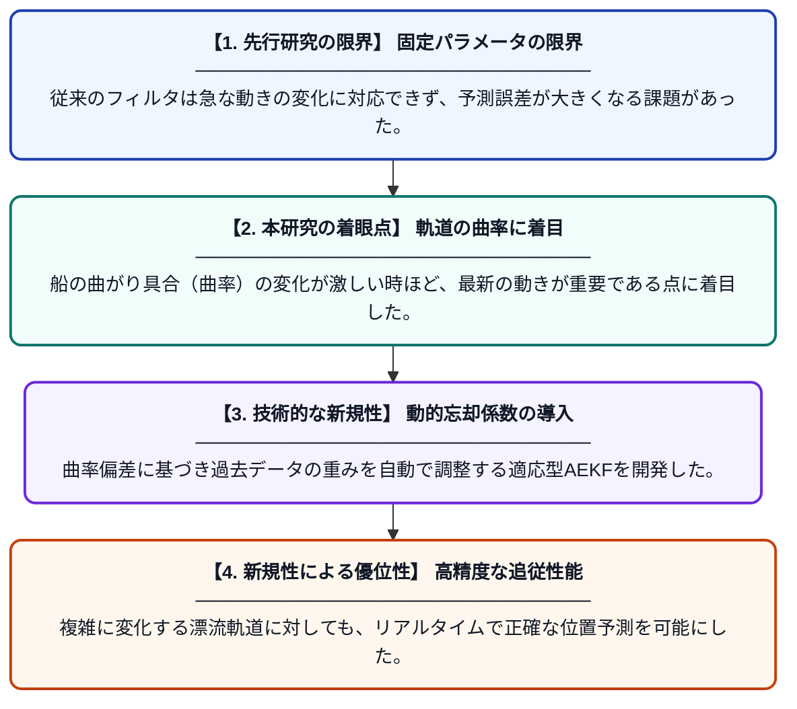

# 動的忘却係数を用いた適応拡張カルマンフィルタによる漂流無人水上艇のリアルタイム軌道予測

**Original Title**: *Real-time trajectory prediction of drifting unmanned surface vessels using an adaptive extended Kalman filter with dynamic forgetting factor*

> **💡 一言要約**: 漂流する無人艇の動きを独自のAIフィルタで予測

| 項目 | 内容 |
|---|---|
| **著者** | J Kim, S Eom, HS Jang, JC Park, Y Kim, SY Lim, Y Kim… |
| **掲載誌** | Ocean Engineering 2027 |
| **アラートキーワード** | kalman filter |
| **原文リンク** | [https://www.sciencedirect.com/science/article/pii/S0029801826049930](https://www.sciencedirect.com/science/article/pii/S0029801826049930) |
| **PDF版要約** | [README.pdf](./README.pdf) |

---

## 📊 新規性の図解（先行研究との違いと本研究のブレークスルー）

## 📝 要約

海洋環境における無人水上艇（USV）の不規則な漂流軌道を正確に予測するため、曲率偏差に基づいた動的忘却係数を組み込んだ適応拡張カルマンフィルタ（AEKF）を提案しています。この手法により、風や波の影響で刻々と変化する漂流運動に対しても、リアルタイムで高精度な予測が可能になります。

## ❓ どんな問題に取り組んだか

海上の無人艇（USV）が故障等で漂流する際、風や潮流の影響で動きが複雑かつ不規則になり、従来のカルマンフィルタでは予測精度が低下するという課題がありました。特に急な動きの変化に対応できず、救助や回収の遅れにつながるリスクがありました。

## ✨ 何が新しい？何がすごい？（新規性）

本研究の最大の特徴は、軌道の「曲率」の変化に応じて忘却係数をリアルタイムで調整する独自の適応メカニズムをAEKFに導入した点です。従来の固定的なパラメータ設定とは異なり、運動の変化が激しい時には過去のデータの重みを減らし、最新の観測値を重視することで予測精度を飛躍的に向上させました。これにより、先行研究では困難だった急激な漂流パターンの変化にもリアルタイムで追従できる予測モデルを実現しています。

## 🎓 大学1年生向けの解説

海に浮かぶ無人の船が、故障などで流されてしまった時に「次にどこへ行くか」を予測する技術についての研究です。海には波や風があるため、船はあちこちへフラフラと動いてしまい、予測がとても難しいです。そこでこの研究では、船が大きく曲がった瞬間に「古いデータよりも今の動きを信じる」という賢い計算方法を開発しました。これによって、遭難した船の場所を素早く正確に突き止めることができるようになります。
