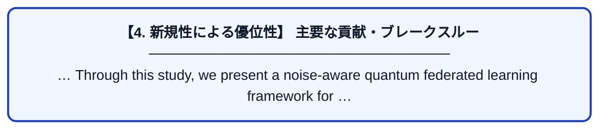

# Noise-aware quantum federated learning for NISQ IoT edge computing: Trainability, communication–accuracy trade-offs, and noise-reliability-weighted aggregation

| 項目 | 内容 |
|---|---|
| **著者** | S Youm |
| **掲載誌** | Future Generation Computer Systems 2026 |
| **アラートキーワード** | Federated Learning |
| **原文リンク** | [https://www.sciencedirect.com/science/article/pii/S0167739X26005200](https://www.sciencedirect.com/science/article/pii/S0167739X26005200) |
| **PDF版要約** | [README.pdf](./README.pdf) |

---

## 📊 新規性の図解（先行研究との違いと本研究のブレークスルー）

## 📝 要約

… Through this study, we present a noise-aware quantum federated learning framework for … Federated learning (FL) has emerged as a leading paradigm for training such models without … Recent works have demonstrated the feasibility of …
