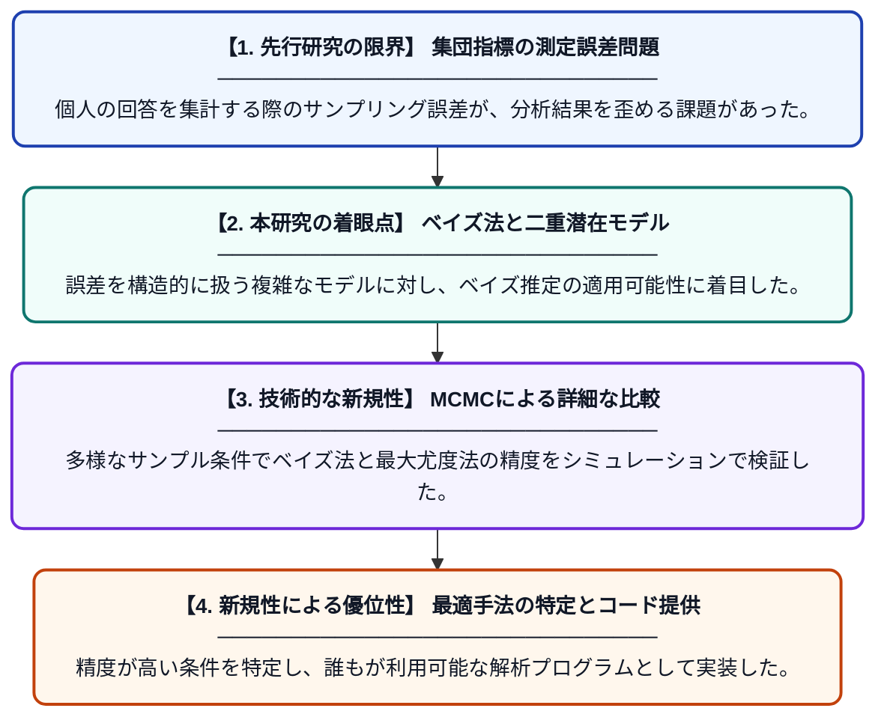

# レベル1で測定されたクラスターレベル予測変数のベイズ推定：バイアス、区間被覆率、および最大尤度法との比較

**Original Title**: *Bayesian Estimation of Cluster-Level Predictors Measured at Level 1: Bias, Interval Coverage, and Comparison With Maximum Likelihood*

> **💡 一言要約**: 集団特性をベイズ法で正確に導くための実践的ガイド

| 項目 | 内容 |
|---|---|
| **著者** | KT Afolabi, TR Konold, EA Sanders |
| **掲載誌** | Frontiers in Psychology |
| **アラートキーワード** | MCMC |
| **原文リンク** | [https://www.frontiersin.org/journals/psychology/articles/10.3389/fpsyg.2026.1985792/full](https://www.frontiersin.org/journals/psychology/articles/10.3389/fpsyg.2026.1985792/full) |
| **PDF版要約** | [README.pdf](./README.pdf) |

---

## 📊 新規性の図解（先行研究との違いと本研究のブレークスルー）

## 📝 要約

マルチレベルモデルにおいて、個人の回答から集団レベルの特性を推定する際のベイズ推定（MCMC）の精度を検証した研究です。二重潜在モデルとマニフェスト集計モデルを対象に、最大尤度法（ML）と比較しながら、推定値のバイアスや95%信頼区間の的中率をシミュレーションで明らかにしました。

## ❓ どんな問題に取り組んだか

学校や組織などの集団特性を個人の回答の平均値で代用すると、サンプリング誤差により統計的なバイアスが生じやすいという課題があります。近年普及しているベイズ推定が、従来の最大尤度法と比較して、どの程度この誤差を補正し正確な結論を導き出せるのかが不明確でした。

## ✨ 何が新しい？何がすごい？（新規性）

本研究は、集団レベルの予測変数を扱う「二重潜在モデル」において、ベイズMCMC推定の有効性を体系的に評価した点が特徴です。先行研究で不十分だった小規模サンプルや異なる級内相関係数（ICC）条件下での挙動を網羅し、ベイズ法特有のバイアス発生パターンを特定しました。また、実務者がすぐに応用できるよう、ユーザーフレンドリーなMplusコードを公開し、理論と実践の橋渡しを行っています。

## 🎓 大学1年生向けの解説

例えば「クラスの仲の良さ」を測る際、全員にアンケートを取って平均を出しますが、少人数のクラスだと一人の回答の偏りが全体の数値に大きく影響してしまいます。この論文は、そのようなデータの偏りを「ベイズ法」という最新の数学的手法でどこまで正しく修正できるかを調べたものです。研究の結果、どのような条件ならこの手法が信頼できるのかが分かり、学校教育や心理学の研究がより正確に行えるようになります。
