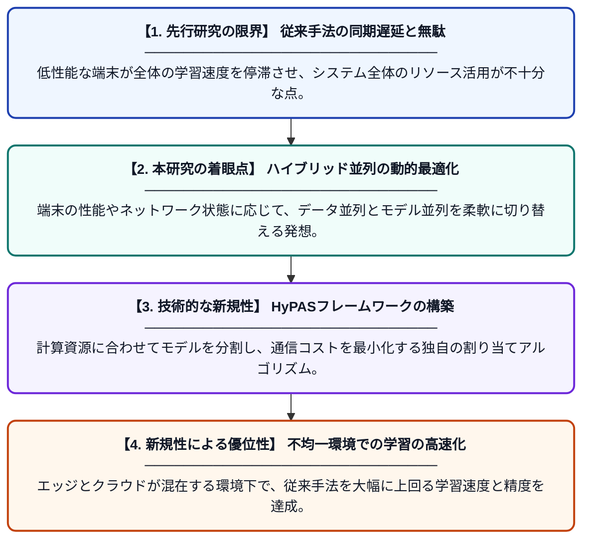

# HyPAS: エッジ・クラウドシステムにおける分散深層学習のための効率的なハイブリッド並列化手法

**Original Title**: *HyPAS: Efficient Hybrid Parallelism for Distributed Deep Learning in Edge–Cloud Systems*

> **💡 一言要約**: 性能がバラバラな端末群でAI学習を劇的に速める

| 項目 | 内容 |
|---|---|
| **著者** | NH Thanh, MV Duc, TD Truong, NNK Duy, NA Hao… |
| **掲載誌** | IEEE Transactions on Cloud … 2026 |
| **アラートキーワード** | distributed deep learning ... |
| **原文リンク** | [https://ieeexplore.ieee.org/abstract/document/11753434/](https://ieeexplore.ieee.org/abstract/document/11753434/) |
| **PDF版要約** | [README.pdf](./README.pdf) |

---

## 📊 新規性の図解（先行研究との違いと本研究のブレークスルー）

## 📝 要約

エッジデバイスとクラウドが混在する不均一な環境において、深層学習を効率化するハイブリッド並列化フレームワーク「HyPAS」を提案しています。デバイス間の性能差やデータの不均一性によって生じる同期の遅れを解消し、学習速度とリソース利用率を最適化します。

## ❓ どんな問題に取り組んだか

従来のデータ並列化手法では、性能の低いデバイスが全体の同期を遅らせる「ストラグラー問題」が発生し、学習効率が著しく低下します。特にエッジとクラウドが混在する環境では、ハードウェア性能や通信環境の差が深刻なボトルネックとなります。

## ✨ 何が新しい？何がすごい？（新規性）

本研究の核心は、データ並列とモデル並列を柔軟に組み合わせる「HyPAS」を提案した点にあります。先行研究が主に均一なハードウェアを前提としていたのに対し、本手法は各デバイスの計算能力を動的に評価し、最適な作業分担を決定します。これにより、不均一な環境下でも通信コストを抑えつつ、大規模モデルの効率的な学習を可能にしました。

## 🎓 大学1年生向けの解説

複数のコンピュータを協力させてAIを育てる際、これまでは一番動きが遅いコンピュータに全員が合わせる必要があり、待ち時間が無駄になっていました。この研究では、各コンピュータの「得意・不得意」を見極めて、作業の進め方を賢く変える仕組みを作りました。これにより、性能がバラバラなスマホやサーバーが混ざっていても、みんなで効率よく、かつ高速にAIを賢くできるようになります。
