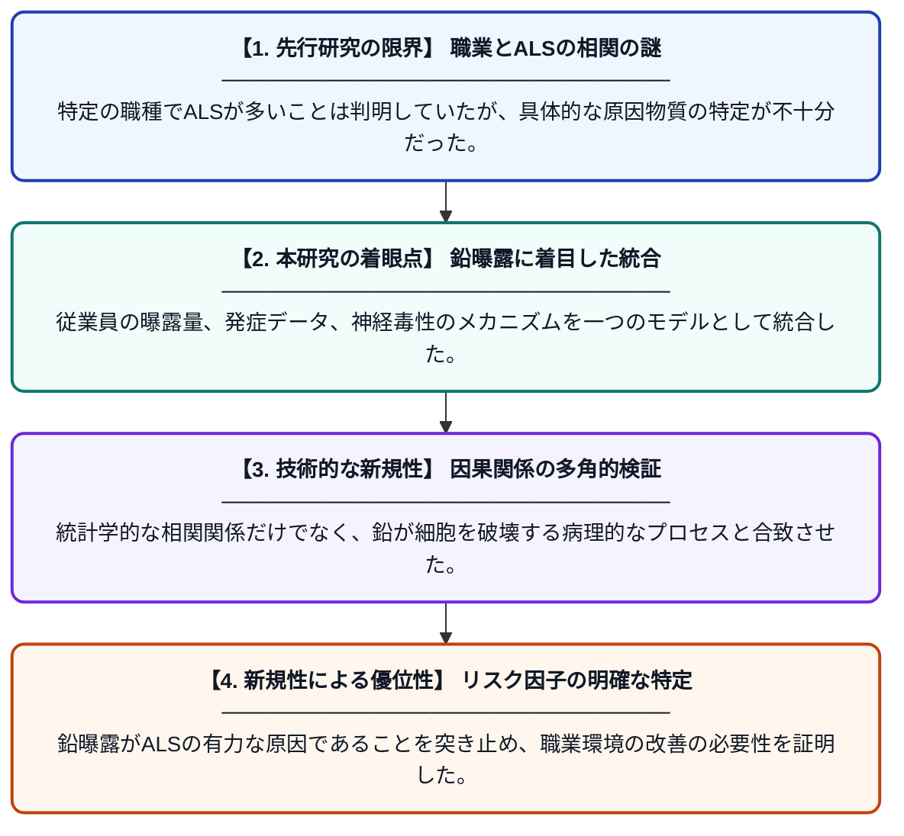

# ガソリンスタンド従業員における血中鉛濃度の増加とALSリスク上昇の関連性について

**Original Title**: *On a connection between increased blood lead concentrations and increased ALS risk in gasoline station forecourt attendants*

> **💡 一言要約**: ガソリンの鉛曝露がALS発症の主要な要因である可能性を解明

| 項目 | 内容 |
|---|---|
| **著者** | SKTS Wärmländer, UA Tshoni, JO Olowoyo… |
| **掲載誌** | Brain Mechanisms 2026 |
| **アラートキーワード** | ALS |
| **原文リンク** | [https://www.sciencedirect.com/science/article/pii/S3050642526000436](https://www.sciencedirect.com/science/article/pii/S3050642526000436) |
| **PDF版要約** | [README.pdf](./README.pdf) |

---

## 📊 新規性の図解（先行研究との違いと本研究のブレークスルー）

## 📝 要約

ガソリンスタンドの従業員において筋萎縮性側索硬化症（ALS）の発症リスクが高い原因を調査し、血中鉛濃度との関連を分析した論文です。既存の疫学データと鉛の神経毒性メカニズムを統合した結果、鉛への曝露がALS発症の直接的な要因である可能性が高いと結論付けています。

## ❓ どんな問題に取り組んだか

特定の職業、特にガソリンスタンド従業員においてALSの発症率が高いことが以前から指摘されていましたが、その具体的な原因は特定されていませんでした。鉛が神経に悪影響を与えることは知られていたものの、職業的な曝露量とALSの発症メカニズムを直接結びつける証拠が不足していました。

## ✨ 何が新しい？何がすごい？（新規性）

本研究は、ガソリンスタンド従業員のALS発症率、実際の鉛曝露レベル、および鉛が神経変性を引き起こす病理学的プロセスの3要素を初めて統合して評価した点が画期的です。先行研究が統計的な相関に留まっていたのに対し、本論文は鉛の生化学的性質からALS発症までの因果関係を具体的に提示しました。これにより、環境毒素が難病発症に果たす役割をより強固に裏付けたことが大きな貢献です。

## 🎓 大学1年生向けの解説

ALS（筋萎縮性側索硬化症）は、筋肉を動かす神経が壊れてしまう原因不明の難病です。この研究では、ガソリンスタンドで働く人たちにこの病気が多い理由を調べ、ガソリンに含まれる「鉛」が犯人である可能性を突き止めました。鉛が体に入ると、神経細胞を傷つける毒として働き、それがALSにつながるという仕組みを詳しく説明しています。私たちの身の回りの環境が、どのように深刻な病気に関わっているかを教えてくれる研究です。
