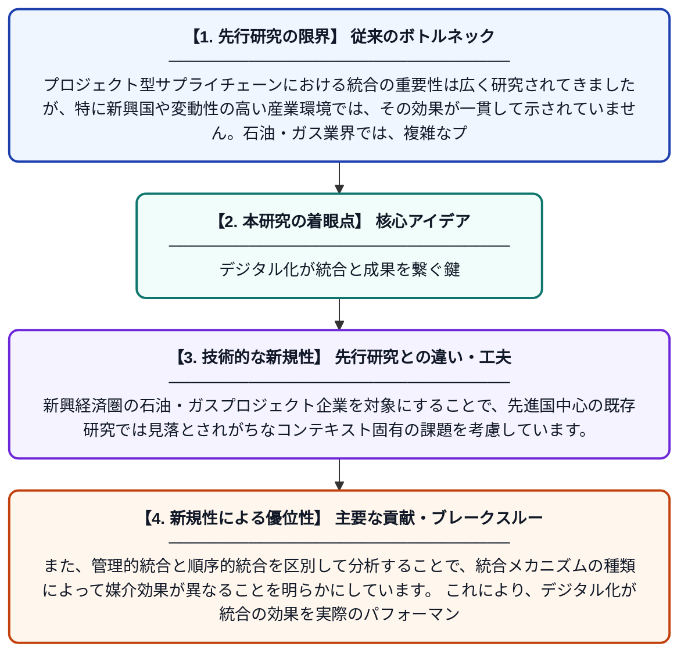

# 統合からパフォーマンスへ：石油・ガスプロジェクト企業におけるデジタル物流とサプライチェーンネットワークの媒介効果の探索

**Original Title**: *From integration to performance: exploring the mediating roles of digital logistics and supply chain networks in oil and gas project firms*

> **💡 一言要約**: デジタル化が統合と成果を繋ぐ鍵

| 項目 | 内容 |
|---|---|
| **著者** | NE John, B Ameh, E Akpan |
| **掲載誌** | The International Journal of Logistics Management 2026 |
| **アラートキーワード** | logistics |
| **原文リンク** | [https://www.emerald.com/ijlm/article-abstract/doi/10.1108/IJLM-06-2025-0427/1389504](https://www.emerald.com/ijlm/article-abstract/doi/10.1108/IJLM-06-2025-0427/1389504) |
| **PDF版要約** | [README.pdf](./README.pdf) |

---

## 📊 新規性の図解（先行研究との違いと本研究のブレークスルー）

## 📝 要約

本研究は、プロジェクト型サプライチェーンにおける管理的・順序的な統合メカニズムが、いかにして企業パフォーマンスに影響を与えるかを調査したものです。特に、デジタル物流とサプライチェーンネットワークが統合とパフォーマンスの関係を媒介する役割に着目しています。新興経済圏かつ変動の激しい石油・ガス産業を対象に、統合施策の効果が一貫しない原因を明らかにすることを目的としています。

## ❓ どんな問題に取り組んだか

プロジェクト型サプライチェーンにおける統合の重要性は広く研究されてきましたが、特に新興国や変動性の高い産業環境では、その効果が一貫して示されていません。石油・ガス業界では、複雑なプロジェクト構造と不安定な市場環境が相まって、統合施策が期待通りのパフォーマンス向上につながらないケースが多く見られます。この「統合とパフォーマンスのギャップ」を埋めるメカニズムの解明が急務となっています。

## ✨ 何が新しい？何がすごい？（新規性）

先行研究の多くは統合とパフォーマンスの直接的な関係を検証してきましたが、本研究はデジタル物流とサプライチェーンネットワークという二つの媒介変数を同時に組み込んだ点が独自です。新興経済圏の石油・ガスプロジェクト企業を対象にすることで、先進国中心の既存研究では見落とされがちなコンテキスト固有の課題を考慮しています。また、管理的統合と順序的統合を区別して分析することで、統合メカニズムの種類によって媒介効果が異なることを明らかにしています。これにより、デジタル化が統合の効果を実際のパフォーマンスに転換する「橋渡し役」として機能するという新たな理論的貢献を提示しています。

## 🎓 大学1年生向けの解説

企業がうまく連携（統合）すれば業績が上がると考えられていますが、実際にはそう単純ではありません。この研究では、石油・ガス会社がお互いの仕事をうまく連携させるだけでなく、デジタル技術を使った物流や取引先ネットワークを整備することで、はじめて業績向上につながることを示しています。つまり、連携とデジタル化の両方が揃って初めて効果が出るということです。アフリカなどの新興国の石油・ガス企業を調べることで、先進国とは異なる現実の課題も明らかにしています。この研究は、デジタル化が「連携を成果に変えるための重要な橋渡し役」であることを教えてくれます。
