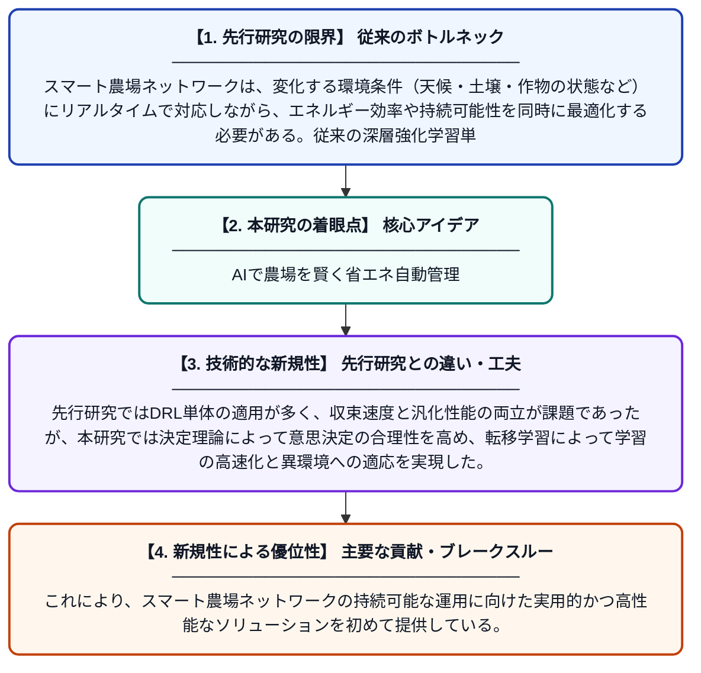

# 持続可能なスマート農場ネットワーク：決定理論に基づく深層強化学習アプローチ

**Original Title**: *Sustainable Smart Farm Networks: A Decision Theory-Guided Deep Reinforcement Learning Approach*

> **💡 一言要約**: AIで農場を賢く省エネ自動管理

| 項目 | 内容 |
|---|---|
| **著者** | D Chen, Z Wan, DS Ha, S Shin, JH Cho |
| **掲載誌** | ACM Transactions on Cyber-Physical Systems 2026 |
| **アラートキーワード** | reinforcement |
| **PDF** | [https://dl.acm.org/doi/pdf/10.1145/3834862](https://dl.acm.org/doi/pdf/10.1145/3834862) |
| **原文リンク** | [https://dl.acm.org/doi/pdf/10.1145/3834862](https://dl.acm.org/doi/pdf/10.1145/3834862) |
| **PDF版要約** | [README.pdf](./README.pdf) |

---

## 📊 新規性の図解（先行研究との違いと本研究のブレークスルー）

## 📝 要約

本論文では、スマート農場ネットワークの効率的な管理を実現するため、深層強化学習（DRL）・決定理論（DT）・転移学習（TL）を統合したハイブリッドフレームワークを提案している。DRLの環境変化への適応力を活かしつつ、収束の遅さという欠点を決定理論と転移学習によって補完する設計となっている。これにより、持続可能かつ自律的なスマート農業の実現を目指している。

## ❓ どんな問題に取り組んだか

スマート農場ネットワークは、変化する環境条件（天候・土壌・作物の状態など）にリアルタイムで対応しながら、エネルギー効率や持続可能性を同時に最適化する必要がある。従来の深層強化学習単体では学習収束が遅く、実際の農業環境への即時適用が困難であった。また、農場ごとの環境差異に対応できる汎化性能も不足していた。

## ✨ 何が新しい？何がすごい？（新規性）

本研究の新規性は、DRL・決定理論・転移学習という3つの異なるAI手法を統合したハイブリッドフレームワークを構築した点にある。先行研究ではDRL単体の適用が多く、収束速度と汎化性能の両立が課題であったが、本研究では決定理論によって意思決定の合理性を高め、転移学習によって学習の高速化と異環境への適応を実現した。これにより、スマート農場ネットワークの持続可能な運用に向けた実用的かつ高性能なソリューションを初めて提供している。

## 🎓 大学1年生向けの解説

スマート農場とは、センサーやAIを使って自動的に作物の管理を行う次世代の農業システムです。しかし、天気や土の状態は常に変わるため、AIがうまく対応するのは難しく、学習に時間がかかるという問題がありました。この論文では、3種類のAI技術を組み合わせることで、農場の状況変化に素早く賢く対応できるシステムを作りました。たとえば、過去に学んだ知識を新しい農場でも使い回せるようにすることで、学習時間を大幅に短縮しています。これにより、エネルギーを無駄にしない、環境にやさしい農業の実現を目指しています。
