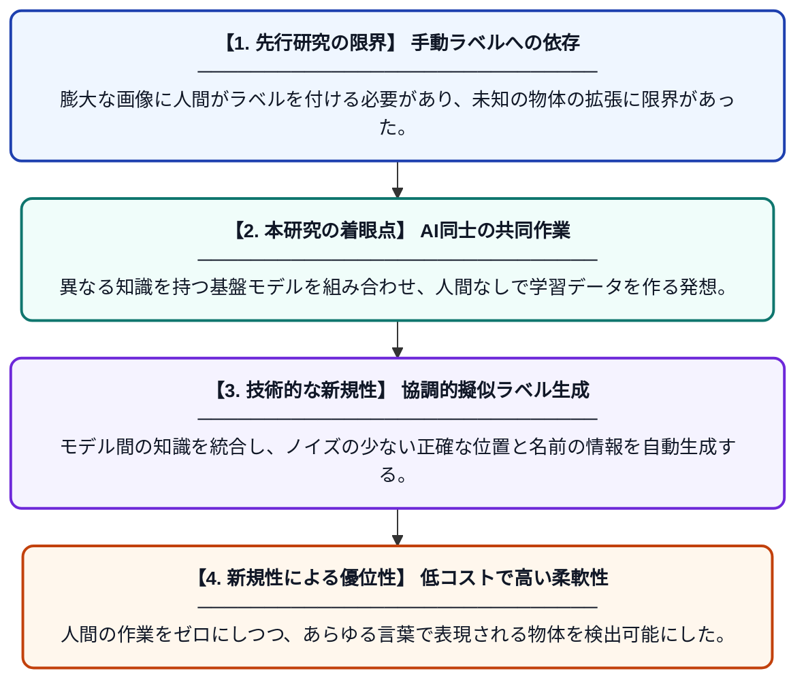

# 基盤モデルの連携によるアノテータ不要の物体検出

**Original Title**: *Annotator-Free Object Detection via Foundation Model Collaboration*

> **💡 一言要約**: AIがAIに教えて、人間いらずで物体検出を学ぶ

| 項目 | 内容 |
|---|---|
| **著者** | Y Ranasinghe, VM Patel |
| **掲載誌** | arXiv preprint arXiv:2611.06195 2026 |
| **アラートキーワード** | Open-Vocabulary Object ... |
| **PDF** | [https://arxiv.org/pdf/2611.06195](https://arxiv.org/pdf/2611.06195) |
| **原文リンク** | [https://arxiv.org/pdf/2611.06195](https://arxiv.org/pdf/2611.06195) |
| **PDF版要約** | [README.pdf](./README.pdf) |

---

## 📊 新規性の図解（先行研究との違いと本研究のブレークスルー）

## 📝 要約

複数の強力な基盤モデルを連携させることで、人間の手作業によるラベル付けを一切必要とせずに未知の物体を検出する手法を提案しています。画像とテキストの対応関係を自動で学習し、従来の手法よりも効率的かつ高精度にオープン語彙物体検出を実現しました。

## ❓ どんな問題に取り組んだか

従来のオープン語彙物体検出（OVD）は、膨大な手動アノテーションが必要であったり、自動生成されたラベルの質が低く、特定の物体しか認識できないという課題がありました。また、視覚情報と言語情報を高精度に紐付けるための学習コストが非常に高い点も問題視されていました。

## ✨ 何が新しい？何がすごい？（新規性）

本研究の最大の特徴は、複数の異なる基盤モデルを「コラボレーション」させ、人間のアノテーションなしで高品質な擬似ラベルを生成する点にあります。先行研究が単一のモデルや単純な知識蒸留に頼っていたのに対し、モデル間の相補的な知識を統合することで、ノイズを抑えた精密な物体境界とクラス特定を可能にしました。これにより、教師なしでありながら既存の教師あり手法に迫る柔軟な検出能力を獲得しています。

## 🎓 大学1年生向けの解説

AIに「これは猫だよ」と教えるには、これまでは人間が写真に印を付ける必要がありました。この研究では、すでに色々なことを知っている複数のAI（基盤モデル）同士を協力させることで、人間が教えなくてもAIが勝手に「何がどこにあるか」を学習する仕組みを作りました。いわば、AI同士で勉強会を開いて、新しい知識をどんどん吸収していくような技術です。これにより、人間が頑張ってラベルを付けなくても、AIが初めて見る物まで見つけられるようになります。
