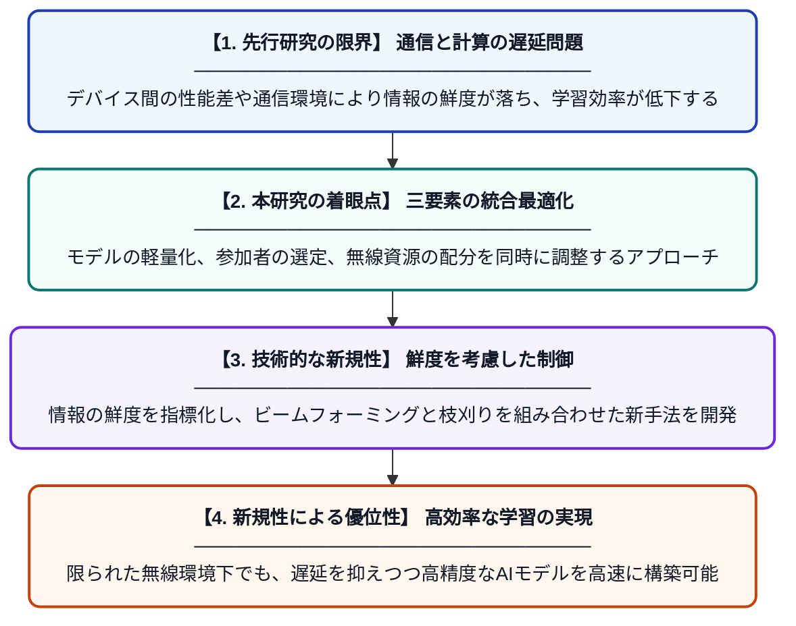

# 無線マルチモーダル連合学習における鮮度を考慮した枝刈りとリソース割り当て

**Original Title**: *Staleness-Aware Pruning and Resource Allocation for Wireless Multimodal Federated Learning*

> **💡 一言要約**: 無線技術とAIの統合最適化で連合学習を高速化

| 項目 | 内容 |
|---|---|
| **著者** | C Xie, Z Chen, W Yi, CT Lam, A Nallanathan |
| **掲載誌** | IEEE Transactions on Vehicular … 2026 |
| **アラートキーワード** | Federated Learning |
| **PDF** | [https://repository.essex.ac.uk/44286/1/mFedDNP_major1.pdf](https://repository.essex.ac.uk/44286/1/mFedDNP_major1.pdf) |
| **原文リンク** | [https://repository.essex.ac.uk/44286/1/mFedDNP_major1.pdf](https://repository.essex.ac.uk/44286/1/mFedDNP_major1.pdf) |
| **PDF版要約** | [README.pdf](./README.pdf) |

---

## 📊 新規性の図解（先行研究との違いと本研究のブレークスルー）

## 📝 要約

無線環境下のマルチモーダル連合学習において、情報の鮮度（Staleness）を考慮しながら、モデルの枝刈り、クライアント選択、無線リソース割り当てを統合的に最適化する手法を提案しました。これにより、通信資源と計算能力の制約がある中で、学習効率と精度の最大化を実現しています。

## ❓ どんな問題に取り組んだか

複数のデータ形式を扱うマルチモーダル連合学習では、通信遅延やデバイスの処理能力差により情報の鮮度が落ち、学習が停滞する課題がありました。また、通信リソースの配分とAIモデルの複雑さを同時に最適化する理論的枠組みが不足していました。

## ✨ 何が新しい？何がすごい？（新規性）

モデルの枝刈りとビームフォーミング技術、クライアントの参加制御を統合的に最適化するフレームワークを世界で初めて提案した点が画期的です。データの鮮度を最適化指標に取り入れることで、遅延の影響を最小限に抑えつつ、マルチモーダルデータの特性に合わせた動的なリソース配分を可能にしました。これにより、不安定な無線ネットワーク環境下でも高い学習精度を維持できます。

## 🎓 大学1年生向けの解説

みんなのスマホが協力して一つのAIを賢くする『連合学習』という仕組みがありますが、通信が遅いと学習に時間がかかってしまいます。この研究では、電波の送り方を工夫したり、AIの難しい部分を少し削って軽くしたりすることで、通信が悪い場所でも効率よく学習できる方法を考えました。動画や音声など複雑なデータを扱う場合でも、この方法を使えばスムーズにAIを育てることが可能になります。
