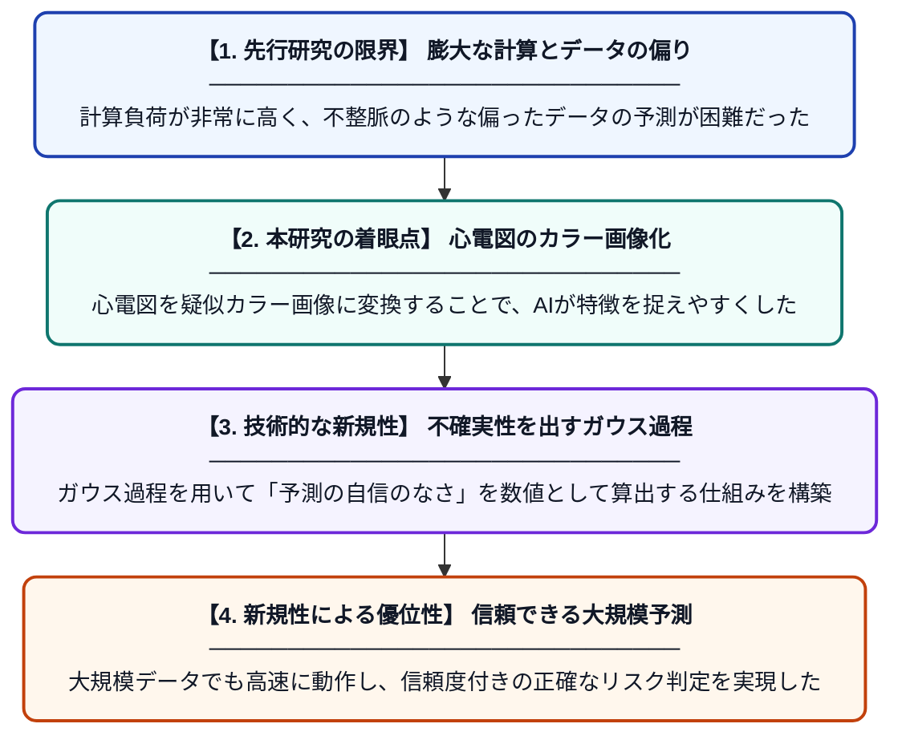

# 疑似カラー心電図を用いたトルサード・ド・ポアンツ・リスクの不確実性定量化ガウス過程分類：UKバイオバンク乳がんコホートにおける外部検証

**Original Title**: *Uncertainty-Quantified Gaussian Process Classification of Torsades de Pointes Risk from Pseudo-Coloured ECGs: External Validation in a UK Biobank Breast Cancer …*

> **💡 一言要約**: カラー心電図とAIで致死的不整脈のリスクと信頼度を予測

| 項目 | 内容 |
|---|---|
| **著者** | M Alhjaili, A Alahmadi |
| **掲載誌** | 2026 |
| **アラートキーワード** | gaussian process |
| **PDF** | [https://assets-eu.researchsquare.com/files/rs-11569821/v1/b049112d-fedd-4c86-98a6-0b8053a9ff23.pdf?c=1793869568](https://assets-eu.researchsquare.com/files/rs-11569821/v1/b049112d-fedd-4c86-98a6-0b8053a9ff23.pdf?c=1793869568) |
| **原文リンク** | [https://www.researchsquare.com/article/rs-11569821/latest.pdf](https://www.researchsquare.com/article/rs-11569821/latest.pdf) |
| **PDF版要約** | [README.pdf](./README.pdf) |

---

## 📊 新規性の図解（先行研究との違いと本研究のブレークスルー）

## 📝 要約

心電図を疑似カラー画像に変換し、ガウス過程分類（GPC）を用いて致死的な不整脈であるトルサード・ド・ポアンツのリスクを予測する手法を提案しました。計算コストの削減とデータの偏り（クラス不均衡）に対策を講じることで、予測の信頼度（不確実性）を伴う高精度な診断を可能にしています。

## ❓ どんな問題に取り組んだか

従来の心電図解析では、データの偏りや膨大な計算コストが原因で、高精度なリスク予測が困難でした。また、AIの予測結果に対して「どれくらい自信があるか」という指標が不足しており、医療現場での判断材料として不十分という課題がありました。

## ✨ 何が新しい？何がすごい？（新規性）

心電図を疑似カラー画像化することで特徴抽出を強化し、ガウス過程を用いることで予測値とともにその「不確実性」を算出可能にした点が革新的です。ガウス過程特有の計算負荷を抑制するアルゴリズムを導入し、大規模なUKバイオバンクのデータセットで外部検証を行うことで、実用的な堅牢性を示しました。特にクラス不均衡を考慮した学習により、稀だが危険なリスク群の識別能力を大幅に向上させています。

## 🎓 大学1年生向けの解説

この研究は、心臓の電気信号である「心電図」をカラフルな画像に変換し、AIを使って危険な不整脈が起きる確率を当てるというものです。ただ「危険」と答えるだけでなく、「AIがどれくらい自信を持ってそう診断したか」という信頼度も一緒に教えてくれます。これにより、お医者さんがAIの意見をどれくらい信じて良いか判断しやすくなります。計算が速くなる工夫もされているため、将来的にたくさんの患者さんの診察に役立つことが期待されています。
