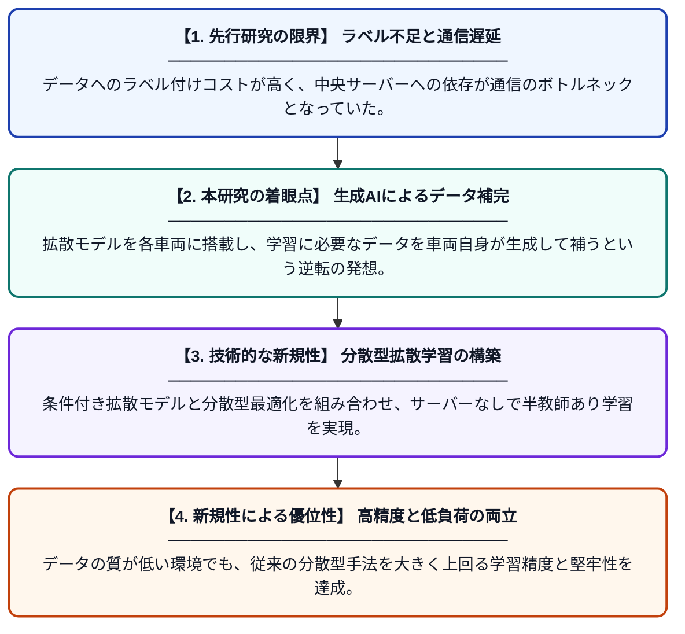

# 拡散モデルを用いた車載ネットワーク向け分散型半教師あり連合学習：DecFLDiff

**Original Title**: *DecFLDiff: Decentralized Semi-Supervised Federated Learning for Vehicular Networks Based on Diffusion Model*

> **💡 一言要約**: 拡散モデルで車載AIのラベル不足を解決

| 項目 | 内容 |
|---|---|
| **著者** | D He, W Wen, Y Chen, J Liao, W Liang, K Li… |
| **掲載誌** | IEEE Transactions on … 2026 |
| **アラートキーワード** | Semi supervise |
| **原文リンク** | [https://ieeexplore.ieee.org/abstract/document/11806022/](https://ieeexplore.ieee.org/abstract/document/11806022/) |
| **PDF版要約** | [README.pdf](./README.pdf) |

---

## 📊 新規性の図解（先行研究との違いと本研究のブレークスルー）

## 📝 要約

車載ネットワークにおけるラベルなしデータの活用と通信の安定性を向上させるため、条件付き拡散モデルを統合した分散型半教師あり連合学習フレームワーク「DecFLDiff」を提案しています。中央サーバーを介さず車両間での知識共有と高品質なデータ生成を行うことで、リソースの制約がある環境でも効率的な学習を可能にしました。

## ❓ どんな問題に取り組んだか

車載ネットワークでは膨大なデータが生成されますが、その多くに正解ラベルを付与するのは困難です。また、従来の中央集権的な連合学習では、通信遅延やプライバシーリスク、単一障害点の問題があり、不安定な車両通信環境には適していませんでした。

## ✨ 何が新しい？何がすごい？（新規性）

本研究の最大の特徴は、画像生成などで用いられる「拡散モデル」を分散型の半教師あり学習に導入した点です。各車両が条件付き拡散モデルを保持し、少量のラベル付きデータから高品質な疑似データを生成することで、データの偏りやラベル不足を補完します。これにより、サーバーレスな環境でも高い認識精度を維持しつつ、通信負荷を最適化する仕組みを確立しました。

## 🎓 大学1年生向けの解説

自動運転車などが集めるデータには、それが「歩行者」か「障害物」かといった正解がついていないものがほとんどです。この研究では、AIが足りない正解データを自分で作り出す「拡散モデル」という技術を車載用にアレンジしました。さらに、大きな親機（サーバー）を使わずに車同士で直接情報を教え合うことで、通信が不安定な場所でもみんなで協力して賢くなれるシステムを作りました。
