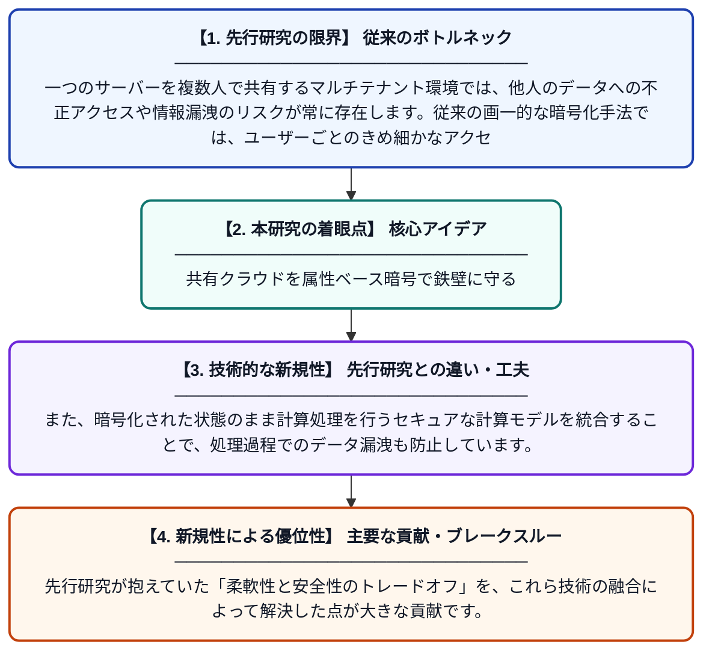

# マルチテナント・クラウド環境におけるクラウドコンピューティングのセキュリティ課題と解決策

**Original Title**: *Cloud Computing Security Challenges in Multi-Tenant Cloud Computing Environments*

> **💡 一言要約**: 共有クラウドを属性ベース暗号で鉄壁に守る

| 項目 | 内容 |
|---|---|
| **著者** | PK Rawat, M Vidya, GML Sangeetha, S Saravanan… |
| **掲載誌** | 7th International … 2026 |
| **アラートキーワード** | Secure Computing |
| **原文リンク** | [https://ieeexplore.ieee.org/abstract/document/11736004/](https://ieeexplore.ieee.org/abstract/document/11736004/) |
| **PDF版要約** | [README.pdf](./README.pdf) |

---

## 📊 新規性の図解（先行研究との違いと本研究のブレークスルー）

## 📝 要約

複数の利用者がリソースを共有するマルチテナント型クラウドにおいて、データの機密性と細やかなアクセス制御を実現するフレームワークを提案しています。属性ベース暗号（ABE）やセキュアな計算手法を組み合わせることで、共有環境特有のセキュリティリスクの解消を図っています。

## ❓ どんな問題に取り組んだか

一つのサーバーを複数人で共有するマルチテナント環境では、他人のデータへの不正アクセスや情報漏洩のリスクが常に存在します。従来の画一的な暗号化手法では、ユーザーごとのきめ細かなアクセス権限の管理と、データの機密保持を両立させることが困難でした。

## ✨ 何が新しい？何がすごい？（新規性）

本研究は、属性ベース暗号（ABE）を活用したフレームワークを導入し、ユーザーの職位や所属などの「属性」に基づいた動的で詳細なアクセス制御を可能にしました。また、暗号化された状態のまま計算処理を行うセキュアな計算モデルを統合することで、処理過程でのデータ漏洩も防止しています。先行研究が抱えていた「柔軟性と安全性のトレードオフ」を、これら技術の融合によって解決した点が大きな貢献です。

## 🎓 大学1年生向けの解説

クラウドは、一つの大きなマンションにたくさんの人が住んでいるような状態です。もし隣の部屋の人が自分の部屋を勝手に見られたら困りますよね。この研究は、「正しい鍵（属性）」を持っている人だけが自分のデータに触れることができ、さらに暗号を解かなくても計算ができる不思議な技術を使って、マンション全体の安全を劇的に高める方法を提案しています。
