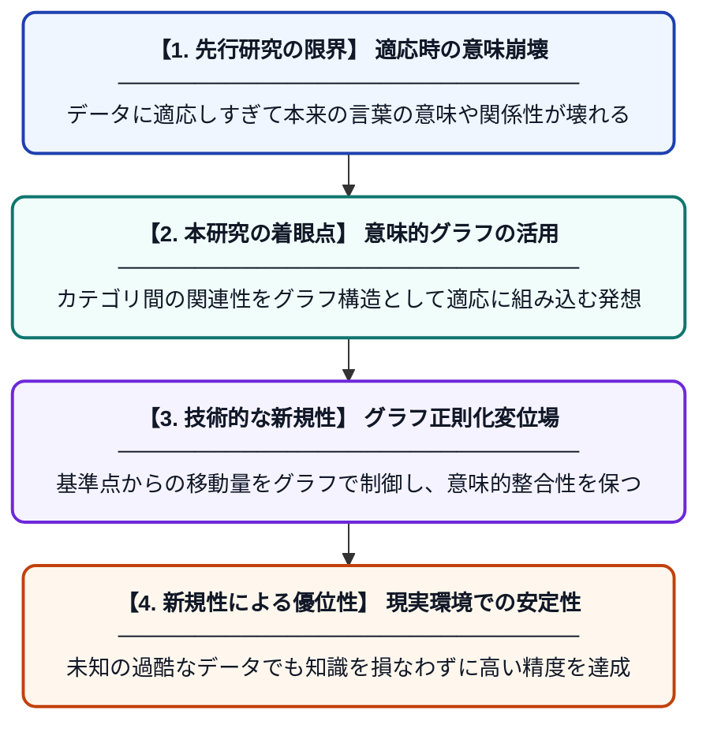

# GRAFT：グラフ正則化プロトタイプ場による視覚言語モデルの現実的なテスト時適応

**Original Title**: *GRAFT: Graph-Regularized Prototype Fields for Realistic Test-Time Adaptation of VLMs*

> **💡 一言要約**: グラフの力でCLIPの知識を守りつつ未知の画像に適応

| 項目 | 内容 |
|---|---|
| **著者** | MR Rahman, W Maass |
| **掲載誌** | arXiv preprint arXiv:2611.23591 2026 |
| **アラートキーワード** | Markov random"  fields |
| **PDF** | [https://arxiv.org/pdf/2611.23591](https://arxiv.org/pdf/2611.23591) |
| **原文リンク** | [https://arxiv.org/pdf/2611.23591](https://arxiv.org/pdf/2611.23591) |
| **PDF版要約** | [README.pdf](./README.pdf) |

---

## 📊 新規性の図解（先行研究との違いと本研究のブレークスルー）

## 📝 要約

視覚言語モデル（VLM）を未知のデータに適応させる際、意味的な一貫性を保ちつつ高精度な予測を行う手法「GRAFT」を提案しました。テキストアンカーに変位場を加え、カテゴリ間のグラフ構造を用いた正則化を導入することで、モデルの破綻を防いでいます。

## ❓ どんな問題に取り組んだか

従来のテスト時適応（TTA）手法では、未知のデータに合わせようとするあまり、モデルが本来持っていた単語の意味的な知識が崩壊してしまう課題がありました。特に、カテゴリ間の関連性が無視されることで、実世界の複雑なデータに対する汎用性が失われる傾向にありました。

## ✨ 何が新しい？何がすごい？（新規性）

本研究は、適応後のプロトタイプを「テキストアンカー（基準点）＋変位場」として定式化し、その変位をクラス間の意味グラフに基づいてガウス・マルコフ確率場で正則化する手法を開発しました。これにより、個別のカテゴリを独立に調整するのではなく、意味的に近いカテゴリが協調して移動する仕組みを実現しています。これは、従来の独立な最適化手法と比較して、構造的な知識を維持しながら適応できる点で非常に優れています。

## 🎓 大学1年生向けの解説

画像と文字をセットで理解するAIを、現場の画像に合わせて少しずつ「微調整」する技術についての研究です。これまでは、無理に合わせようとするとAIが元々持っていた言葉の意味を忘れてしまう問題がありました。この論文では、言葉同士の『親戚関係』をグラフで表し、似た意味の言葉は一緒に調整されるように工夫しました。その結果、新しい環境でも言葉の意味を正しく保ったまま、賢く進化できるようになりました。
