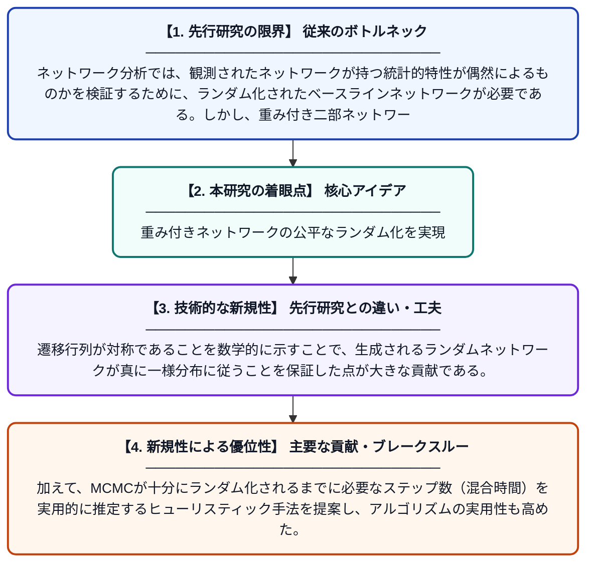

# 次数と強度の系列を正確に保つ重み付き二部ネットワークの不偏ランダム化

**Original Title**: *Unbiased randomization of weighted bipartite networks with exact degree and strength sequences*

> **💡 一言要約**: 重み付きネットワークの公平なランダム化を実現

| 項目 | 内容 |
|---|---|
| **著者** | G Glaviano, S Miccichè |
| **掲載誌** | Physical Review E 2026 |
| **アラートキーワード** | MCMC |
| **PDF** | [https://link.aps.org/pdf/10.1103/rn1f-zsgb](https://link.aps.org/pdf/10.1103/rn1f-zsgb) |
| **原文リンク** | [https://link.aps.org/pdf/10.1103/rn1f-zsgb](https://link.aps.org/pdf/10.1103/rn1f-zsgb) |
| **PDF版要約** | [README.pdf](./README.pdf) |

---

## 📊 新規性の図解（先行研究との違いと本研究のブレークスルー）

## 📝 要約

この論文は、重み付き二部ネットワークをランダム化する際に、各ノードの接続数（次数）と接続の重みの合計（強度）を厳密に保持する手法を提案する。モンテカルロ・マルコフ連鎖（MCMC）を用いた手法において、遷移行列が対称であることを示し、アルゴリズムの不偏性を保証している。さらに、MCMCの混合時間を推定するヒューリスティックな方法も提供している。

## ❓ どんな問題に取り組んだか

ネットワーク分析では、観測されたネットワークが持つ統計的特性が偶然によるものかを検証するために、ランダム化されたベースラインネットワークが必要である。しかし、重み付き二部ネットワークにおいて次数（接続数）と強度（重みの合計）を同時に厳密に保持しながら不偏にランダム化する手法は確立されていなかった。この制約を正しく満たさないランダム化は、統計検定にバイアスをもたらす可能性がある。

## ✨ 何が新しい？何がすごい？（新規性）

先行研究では次数または強度の一方しか厳密に保持できないか、バイアスが生じる可能性があったが、本研究はその両方を同時に厳密に保持する不偏なMCMC手法を構築した。遷移行列が対称であることを数学的に示すことで、生成されるランダムネットワークが真に一様分布に従うことを保証した点が大きな貢献である。加えて、MCMCが十分にランダム化されるまでに必要なステップ数（混合時間）を実用的に推定するヒューリスティック手法を提案し、アルゴリズムの実用性も高めた。

## 🎓 大学1年生向けの解説

ネットワークとは人や物事のつながりを表した図で、例えば顧客と商品の購買関係などがあります。こうしたネットワークの特徴が「偶然起こりえる」ものかを調べるには、同じ基本条件を保ちながらランダムに並び替えたネットワークと比較する必要があります。この研究では、各ノードの「つながりの数」と「つながりの強さの合計」を両方とも正確に守りながら、公平にランダム化する方法を開発しました。コインを何度も投げても偏りが出ないように、このアルゴリズムも数学的に偏りがないことが証明されています。これにより、ネットワーク分析の統計検定がより信頼性の高いものになります。
