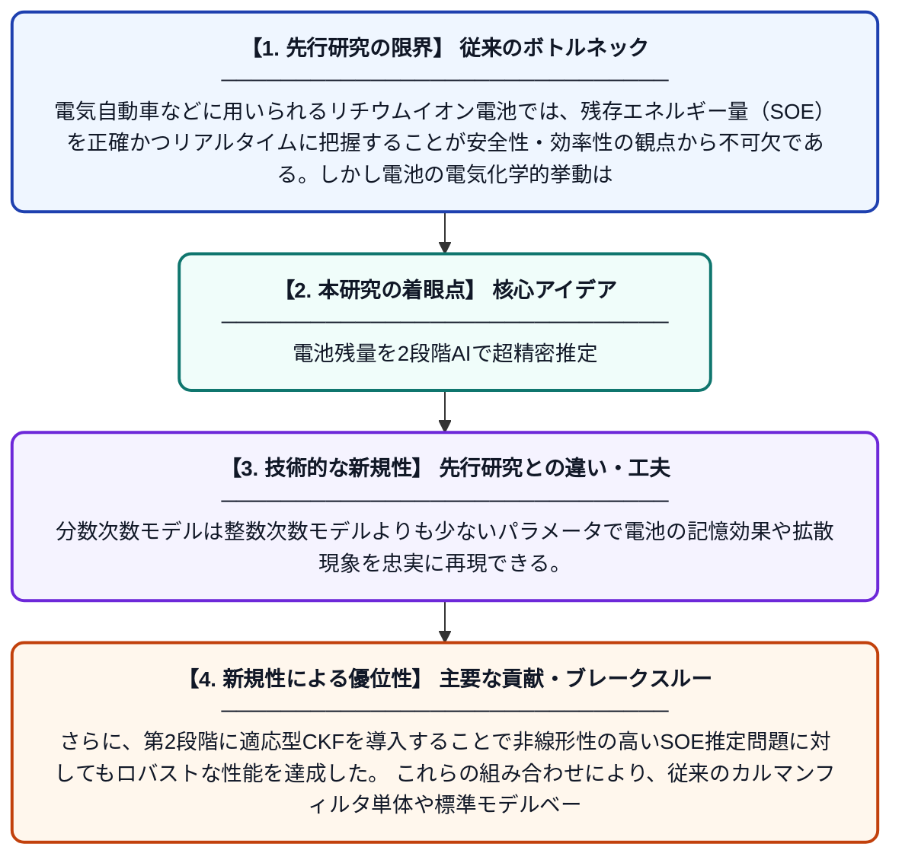

# 分数次数モデルを用いた2段階カルマンフィルタフレームワークによるリチウムイオン電池のエネルギー状態推定

**Original Title**: *A two-stage Kalman filter framework with fractional-order model for state of energy estimation of lithium-ion batteries*

> **💡 一言要約**: 電池残量を2段階AIで超精密推定

| 項目 | 内容 |
|---|---|
| **著者** | C Yang, J Liu, Z Gao, X Zeng, H Wang, S Tan |
| **掲載誌** | IEEE Transactions on Instrumentation and Measurement 2026 |
| **アラートキーワード** | kalman filter |
| **原文リンク** | [https://ieeexplore.ieee.org/abstract/document/11622616/](https://ieeexplore.ieee.org/abstract/document/11622616/) |
| **PDF版要約** | [README.pdf](./README.pdf) |

---

## 📊 新規性の図解（先行研究との違いと本研究のブレークスルー）

## 📝 要約

本論文は、リチウムイオン電池のエネルギー状態（SOE）をリアルタイムで高精度に推定するための2段階カルマンフィルタフレームワークを提案している。第1段階では分数次数モデルを用いて電池の複雑なダイナミクスを精緻に表現し、第2段階では適応型カビチャーカルマンフィルタ（CKF）を活用して非線形性と不確かさを効果的に処理する。これにより、従来手法と比較して推定精度と計算効率の両面で優れた性能を実現している。

## ❓ どんな問題に取り組んだか

電気自動車などに用いられるリチウムイオン電池では、残存エネルギー量（SOE）を正確かつリアルタイムに把握することが安全性・効率性の観点から不可欠である。しかし電池の電気化学的挙動は非線形かつ時変であり、従来の整数次数モデルでは動特性を十分に表現できないという課題があった。さらに、センサノイズやモデル誤差が推定精度を著しく低下させる問題も存在していた。

## ✨ 何が新しい？何がすごい？（新規性）

本研究の最大の新規性は、分数次数微積分に基づく電池モデルと2段階カルマンフィルタを組み合わせた統合フレームワークを初めて提案した点にある。分数次数モデルは整数次数モデルよりも少ないパラメータで電池の記憶効果や拡散現象を忠実に再現できる。さらに、第2段階に適応型CKFを導入することで非線形性の高いSOE推定問題に対してもロバストな性能を達成した。これらの組み合わせにより、従来のカルマンフィルタ単体や標準モデルベース手法を上回る推定精度を実証している。

## 🎓 大学1年生向けの解説

スマートフォンや電気自動車に使われるリチウムイオン電池は、今どれくらいエネルギーが残っているかを正確に知ることがとても重要です。この研究では、電池の動きをより正確に表す「分数次数モデル」という数学的な道具と、ノイズが多い環境でも正確に値を推定できる「カルマンフィルタ」という手法を2段階に組み合わせました。電池の内部はとても複雑なので、普通の方法では誤差が大きくなってしまいますが、この新しい2段階の仕組みでその問題を解決しました。これにより、電気自動車があと何km走れるかをより正確に表示できるようになるなど、私たちの日常生活に直結する技術の向上が期待されます。
