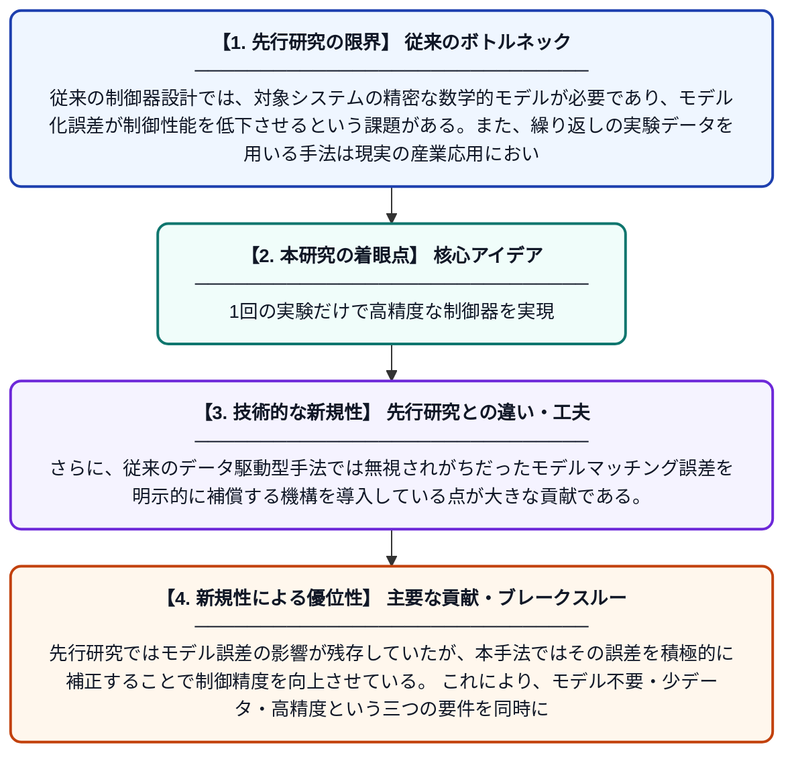

# モデルマッチング誤差補償を用いたワンショットデータ駆動型2自由度コントローラ

**Original Title**: *One‐Shot Data‐Driven Two‐Degree‐of‐Freedom Controller With Model‐Matching Error Compensation*

> **💡 一言要約**: 1回の実験だけで高精度な制御器を実現

| 項目 | 内容 |
|---|---|
| **著者** | S Yahagi, T Sakai, K Hashino, I Kajiwara |
| **掲載誌** | Asian Journal of Control 2026 |
| **アラートキーワード** | one shot |
| **原文リンク** | [https://onlinelibrary.wiley.com/doi/abs/10.1002/asjc.70205](https://onlinelibrary.wiley.com/doi/abs/10.1002/asjc.70205) |
| **PDF版要約** | [README.pdf](./README.pdf) |

---

## 📊 新規性の図解（先行研究との違いと本研究のブレークスルー）

## 📝 要約

本論文は、事前に数学的モデルを必要とせず、一度の実験データ（ワンショットデータ）だけで制御器を設計するデータ駆動型チューニング手法を提案している。特に、2自由度（TDOF）制御構造に対して、モデルマッチング誤差を補償する新しいアプローチを導入している。これにより、従来手法と比べて制御性能の精度と実用性を大幅に向上させることを目指している。

## ❓ どんな問題に取り組んだか

従来の制御器設計では、対象システムの精密な数学的モデルが必要であり、モデル化誤差が制御性能を低下させるという課題がある。また、繰り返しの実験データを用いる手法は現実の産業応用において時間・コスト面で困難を伴う。これらの課題に対し、少ないデータで高性能な制御器を設計する手法の確立が求められていた。

## ✨ 何が新しい？何がすごい？（新規性）

本研究の新規性は、ワンショット（一度きりの実験）データのみを用いて2自由度制御器を設計する点にある。さらに、従来のデータ駆動型手法では無視されがちだったモデルマッチング誤差を明示的に補償する機構を導入している点が大きな貢献である。先行研究ではモデル誤差の影響が残存していたが、本手法ではその誤差を積極的に補正することで制御精度を向上させている。これにより、モデル不要・少データ・高精度という三つの要件を同時に満たす実用的な設計手法を実現している。

## 🎓 大学1年生向けの解説

工場の機械やロボットをうまく動かすには「制御器」と呼ばれるプログラムが必要ですが、普通はその機械の詳しい数式モデルを作るのに時間がかかります。この研究では、機械を一回だけ動かして得たデータだけで、賢い制御器を自動的に作る方法を提案しています。さらに、データだけで作ると生じてしまう「ズレ（誤差）」を自動的に直す仕組みも組み込んでいます。これにより、難しい数式モデルを作らなくても、少ない手間で高性能な制御ができるようになります。
