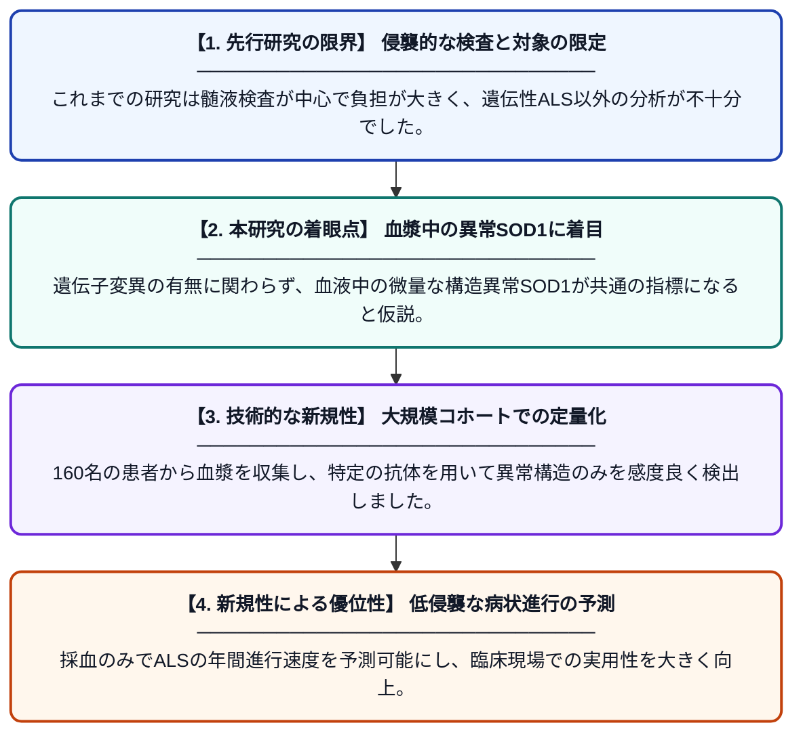

# 筋萎縮性側索硬化症（ALS）における血漿中の異常構造SOD1タンパク質の特性評価

**Original Title**: *Characterization of plasma misfolded superoxide dismutase 1 in amyotrophic lateral sclerosis*

> **💡 一言要約**: 血液中の異常タンパク質がALSの進行を予測する

| 項目 | 内容 |
|---|---|
| **著者** | YC Kuo, CH Ting, HJ Lai, PY Huang, YA Shih… |
| **掲載誌** | Neurobiology of Disease 2026 |
| **アラートキーワード** | ALS |
| **原文リンク** | [https://www.sciencedirect.com/science/article/pii/S0969996126004158](https://www.sciencedirect.com/science/article/pii/S0969996126004158) |
| **PDF版要約** | [README.pdf](./README.pdf) |

---

## 📊 新規性の図解（先行研究との違いと本研究のブレークスルー）

## 📝 要約

160名のALS患者を対象に、血液（血漿）中に含まれる異常な構造をしたSOD1タンパク質を分析しました。その結果、遺伝性の有無に関わらず、この異常タンパク質が病状の進行速度と密接に関連していることが明らかになりました。

## ❓ どんな問題に取り組んだか

ALSは原因が多様で診断や進行予測が難しく、特にSOD1遺伝子変異を持たない患者におけるSOD1タンパク質の役割は不明確でした。また、これまでの検査は身体への負担が大きい脳脊髄液を用いるものが多く、簡便な血液検査による指標が求められていました。

## ✨ 何が新しい？何がすごい？（新規性）

本研究は、160名という大規模な患者群において、遺伝性の有無を問わず血漿中の「ミフォールド（折りたたみ異常）」したSOD1を定量化した点が画期的です。先行研究が主に細胞モデルや少数の症例に基づいていたのに対し、採血という低侵襲な手法で、病状の悪化速度（ALSFRS-Rの年間低下率）を予測できることを実証しました。これにより、SOD1の異常が広範なALS患者に共通する病態メカニズムである可能性を強く示しました。

## 🎓 大学1年生向けの解説

ALSは全身の筋肉が動かなくなる難病で、タンパク質が「変な形」に固まってしまうことが原因の一つと考えられています。これまでは、背中に針を刺して髄液を採るような大変な検査が必要でしたが、この研究は「血液」を調べるだけでその異常を見つけることに成功しました。血液中の異常なタンパク質が多い人ほど、病気の進みが速いことも分かっています。これが実用化されれば、注射一本で病気の状態が予測できるようになります。
