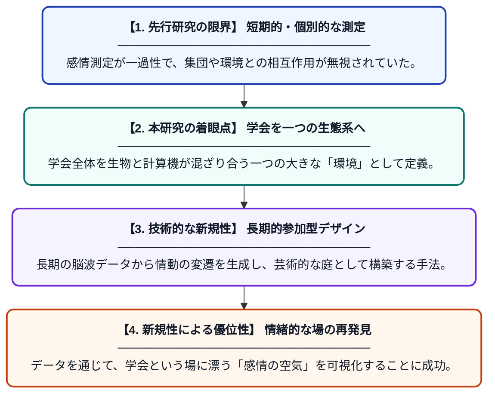

# Signal Garden: 学会への情緒的参加に関する長期的な脳波インスタレーション

**Original Title**: *Signal Garden: A Longitudinal EEG Installation on Affective Conference Presence*

> **💡 一言要約**: 脳波で描く学会の「感情の庭」

| 項目 | 内容 |
|---|---|
| **著者** | VYT Chua, L Xi |
| **掲載誌** | Proceedings of the 34th ACM International Conference … 2026 |
| **アラートキーワード** | affective computing |
| **原文リンク** | [https://dl.acm.org/doi/abs/10.1145/3767308.3838302](https://dl.acm.org/doi/abs/10.1145/3767308.3838302) |
| **PDF版要約** | [README.pdf](./README.pdf) |

---

## 📊 新規性の図解（先行研究との違いと本研究のブレークスルー）

## 📝 要約

学会を生物学的・計算論的な「生態系」と見なし、参加者の脳波（EEG）データを長期間にわたり収集・可視化するインスタレーションを提案しています。情動コンピューティングと参加型デザインを融合させ、学会という場のダイナミズムを新しい視点で捉え直す試みです。

## ❓ どんな問題に取り組んだか

学会における個人の情緒的な変化や体験は、これまで主観的な感想にとどまり、客観的かつ長期的に可視化されることがありませんでした。また、参加者全体の相互作用を一つの統合されたシステムとして捉える手法も不足していました。

## ✨ 何が新しい？何がすごい？（新規性）

本研究は「テクノエコロジー」の概念を導入し、個人の脳波を単なるデータではなく、コミュニティという生態系を構成する要素として扱った点が革新的です。長期間（Longitudinal）のデータ収集を行い、それを芸術的な「庭」として展示することで、参加者が自分たちの情動をメタ視点で認識できる仕組みを構築しました。先行研究が個別の感情認識に集中していたのに対し、集団的な共創プロセスを重視した点が大きな貢献です。

## 🎓 大学1年生向けの解説

私たちが学会に参加しているとき、頭の中ではワクワクしたり、少し疲れたりと、さまざまな感情が動いています。この研究は、その脳の活動を「脳波」として測定し、みんなの感情の変化をデジタルな「庭」のようなアートとして映し出す装置を作りました。自分たちの感情が集まることで一つの美しい景色が出来上がるのを見て、自分たちが大きなシステムの一部であることを実感できる仕組みになっています。
