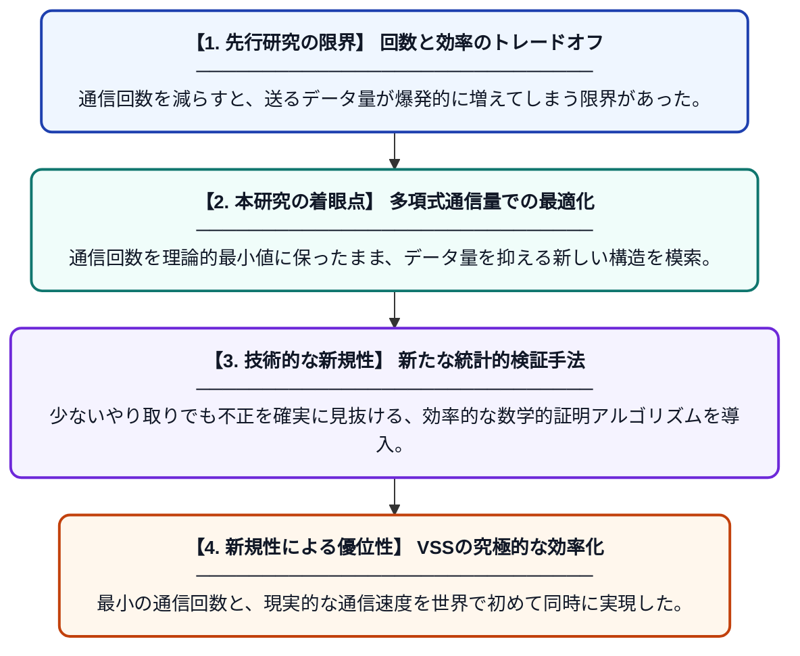

# 多項式時間計算量を持つラウンド最適な統計的検証可能秘密分散法

**Original Title**: *Round-Optimal Statistical Verifiable Secret Sharing with Polynomial Complexity*

> **💡 一言要約**: 統計的VSSで最小通信回数と効率性を初めて両立！

| 項目 | 内容 |
|---|---|
| **著者** | CD Liu-Zhang, E Masserova |
| **掲載誌** | Cryptology ePrint Archive 2026 |
| **アラートキーワード** | Secure Computing |
| **原文リンク** | [https://eprint.iacr.org/2026/2818](https://eprint.iacr.org/2026/2818) |
| **PDF版要約** | [README.pdf](./README.pdf) |

---

## 📊 新規性の図解（先行研究との違いと本研究のブレークスルー）

## 📝 要約

不正な参加者がいても秘密を正しく共有できる「検証可能秘密分散法（VSS）」において、通信回数（ラウンド数）を理論上の最小値まで削減しつつ、通信量を現実的な多項式サイズに抑えることに初めて成功しました。1989年に統計的VSSの実現可能性が示されて以来の難題であった、ラウンド最適性と効率性の両立を解決しています。

## ❓ どんな問題に取り組んだか

統計的安全性を備えた検証可能秘密分散法（VSS）において、通信の「回数（ラウンド数）」を減らそうとすると、通信する「データ量」が膨大になってしまうというジレンマがありました。特に、理論上の最小ラウンド数で動作しながら、実用的な多項式時間で計算・通信が終わる手法はこれまで存在しませんでした。

## ✨ 何が新しい？何がすごい？（新規性）

本論文は、統計的VSSにおいて理論上最小のラウンド数を達成しつつ、通信コストを多項式サイズに抑えた世界初のアルゴリズムを提案しました。先行研究では通信回数を減らすと通信量が指数関数的に増大していましたが、本研究は新たな構成手法を用いることでこの障壁を突破しました。これにより、1989年に端を発した統計的VSSの効率性に関する長年の未解決問題に終止符を打ちました。

## 🎓 大学1年生向けの解説

「秘密分散法」は、大切な情報をパズルのピースのようにバラバラにして仲間に配り、悪い人が一人で情報を盗めないようにする技術です。しかし、仲間の中に嘘のピースを配る「裏切り者」がいる場合、正しく情報を復元できません。この論文は、裏切り者がいても確実に情報を守る仕組みにおいて、仲間同士の「話し合いの回数」をギリギリまで減らし、なおかつ「送るデータの量」も少なく済む画期的な方法を発見しました。
