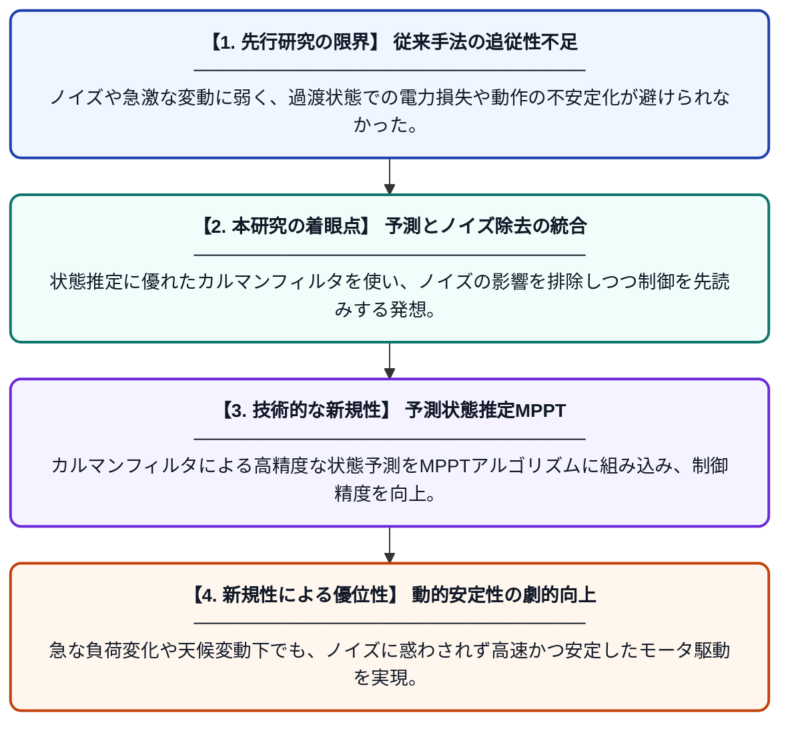

# LVDCマイクログリッドにおけるPV駆動DCモータの動的性能と安定性向上のためのカルマンフィルタを用いた予測状態推定MPPT

**Original Title**: *Predictive State-Estimation MPPT Using a Kalman Filter for Enhanced Dynamic Performance and Stability of a PV-Fed DC Motor Drive in LVDC Microgrid*

> **💡 一言要約**: カルマンフィルタで太陽光駆動モータを高速・安定制御

| 項目 | 内容 |
|---|---|
| **著者** | PS Shete, S Aglawe, DV Nishibkar, VS Gaikwad… |
| **掲載誌** | … International Conference on … 2026 |
| **アラートキーワード** | kalman filter |
| **原文リンク** | [https://ieeexplore.ieee.org/abstract/document/11765436/](https://ieeexplore.ieee.org/abstract/document/11765436/) |
| **PDF版要約** | [README.pdf](./README.pdf) |

---

## 📊 新規性の図解（先行研究との違いと本研究のブレークスルー）

## 📝 要約

本論文は、低電圧直流（LVDC）マイクログリッド内の太陽光発電（PV）で駆動するDCモータにおいて、効率を最大化する新しいMPPT手法を提案しています。カルマンフィルタを用いることで、センサノイズを排除しながら急激な環境変化に対しても高い追従性と安定性を実現しました。

## ❓ どんな問題に取り組んだか

従来のPI制御によるMPPT（最大電力点追従）では、センサから混入するノイズや急激な天候・負荷の変動に追いつけず、システムの安定性が損なわれたり効率が低下したりする課題がありました。特に低電圧グリッド内のモータ駆動では、これらの変動が動作の乱れに直結しやすい点が問題でした。

## ✨ 何が新しい？何がすごい？（新規性）

本研究の核心は、MPPT制御に予測状態推定を行うカルマンフィルタを導入した点にあります。先行研究の多くが従来型のフィードバック制御に依存する中、本手法はノイズ成分を効果的にフィルタリングしつつ、システムの将来状態を予測して最適値を決定します。これにより、MATLAB/Simulinkでの大規模な過渡現象シミュレーションにおいて、従来手法を凌駕する動的応答性能を実証しました。

## 🎓 大学1年生向けの解説

太陽光パネルから電気を取り出してモーターを動かすとき、太陽の光の強さに合わせて「一番パワーが出るポイント」を常に探し続ける必要があります。しかし、機械のノイズや急な雲の動きがあると、これまでの方法では迷ってしまい動作が不安定になっていました。この研究では「カルマンフィルタ」という、ノイズを消して未来を予測する賢い計算手法を使うことで、どんな状況でもスムーズに、かつ最大限の効率でモーターを回すことに成功しました。
