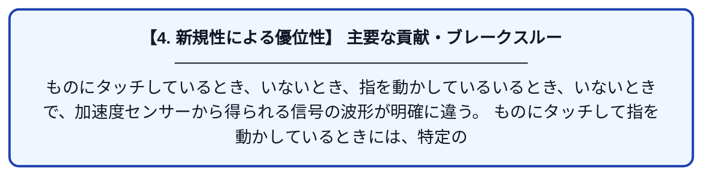

# Ready, Steady, Touch!: Sensing Physical Contact with a Finger-Mounted IMU

| 項目 | 内容 |
|---|---|
| **PDF版要約** | [README.pdf](./README.pdf) |

---

## 📊 新規性の図解（先行研究との違いと本研究のブレークスルー）

## 📝 要約

ものにタッチしているとき、いないとき、指を動かしているいるとき、いないときで、加速度センサーから得られる信号の波形が明確に違う。

ものにタッチして指を動かしているときには、特定の方向にだけ加速度センサーの波形が反応している。
