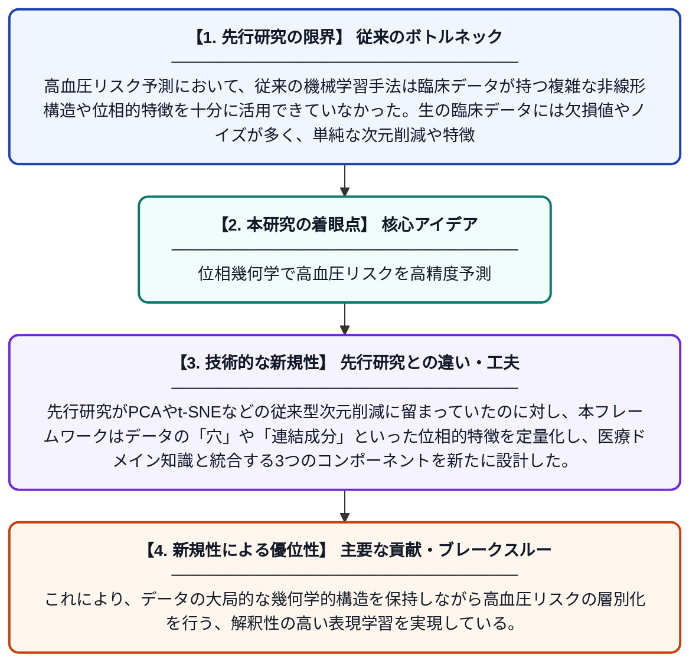

# 高血圧リスク予測のためのトポロジー考慮型多様体学習：持続的ホモロジーとドメイン知識を統合した新しいデータ前処理フレームワーク

**Original Title**: *Topology-aware Manifold Learning for Hypertension Risk Prediction: A Novel Data Preprocessing Framework Integrating Persistent Homology and Domain …*

> **💡 一言要約**: 位相幾何学で高血圧リスクを高精度予測

| 項目 | 内容 |
|---|---|
| **著者** | RA Alotaibi, HM Alshammari, SA Alsaggaf, GA Aljaloud |
| **掲載誌** | Journal of Advanced Trends … 2026 |
| **アラートキーワード** | manifold learning |
| **原文リンク** | [https://www.ovid.com/jnls/atmr/abstract/10.4103/atmr.atmr_6_26~topology-aware-manifold-learning-for-hypertension-risk](https://www.ovid.com/jnls/atmr/abstract/10.4103/atmr.atmr_6_26~topology-aware-manifold-learning-for-hypertension-risk) |
| **PDF版要約** | [README.pdf](./README.pdf) |

---

## 📊 新規性の図解（先行研究との違いと本研究のブレークスルー）

## 📝 要約

本研究は、生の臨床データを構造化された解釈可能な表現に変換し、高血圧リスクの層別化精度を向上させるトポロジー考慮型多様体学習フレームワークを開発した。このフレームワークは持続的ホモロジーとドメイン知識を組み合わせた3つの独自コンポーネントを導入している。従来の前処理手法では捉えにくかった臨床データの複雑な幾何学的・位相的構造を活用することで、高血圧予測の性能向上を目指している。

## ❓ どんな問題に取り組んだか

高血圧リスク予測において、従来の機械学習手法は臨床データが持つ複雑な非線形構造や位相的特徴を十分に活用できていなかった。生の臨床データには欠損値やノイズが多く、単純な次元削減や特徴量エンジニアリングでは患者間の本質的なリスクパターンを捉えることが困難であった。

## ✨ 何が新しい？何がすごい？（新規性）

本研究の最大の新規性は、数学の位相幾何学に基づく「持続的ホモロジー」という手法を臨床データの前処理に初めて体系的に組み込んだ点にある。先行研究がPCAやt-SNEなどの従来型次元削減に留まっていたのに対し、本フレームワークはデータの「穴」や「連結成分」といった位相的特徴を定量化し、医療ドメイン知識と統合する3つのコンポーネントを新たに設計した。これにより、データの大局的な幾何学的構造を保持しながら高血圧リスクの層別化を行う、解釈性の高い表現学習を実現している。

## 🎓 大学1年生向けの解説

高血圧（血圧が高い状態）になるリスクを、患者のデータからAIで予測しようとする研究です。患者の血圧や年齢などのデータは複雑な形をしており、普通の方法では見えないパターンが隠れています。この研究では「トポロジー（位相幾何学）」という数学を使って、そのデータの隠れた形や構造を発見する新しい方法を開発しました。コーヒーカップとドーナツが数学的に同じ形とみなされるように、データの「穴」や「つながり」を分析することで、より正確に高リスク患者を見つけ出せるようになります。
